# Общая архитектура

[К содержанию](README.md)

Ядро Jarvis принимает события, ведёт разговоры, запускает агентский цикл и обращается к памяти и инструментам. Temporal управляет продолжением работы после ожиданий и сбоев. В MVP пользователь общается через Telegram. Отдельные машины для выполнения рабочих действий относятся к следующему этапу; на схеме они показаны пунктиром.

[Исходник схемы](diagrams/components.mmd)

Yandex Search подключается опционально. Без его настроек ядро запускается с чтением публичных страниц по ссылкам, но без инструмента поиска.

## Бэкенд и доступ к моделям

Бэкенд и workers Jarvis реализуются на Go (Golang), взаимодействие с Temporal — через Go SDK.

Для вызовов LLM используется адаптер OpenAI-совместимых API. Провайдер и конкретная модель выбираются в настройках запуска Jarvis. Запущенный экземпляр использует этот выбор для вызовов модели; автоматической маршрутизации по моделям нет. Для смены модели меняются настройки следующего запуска. Ядро работает через общий адаптер и не привязывается к одной модели или одному провайдеру.

В истории выполнения сохраняются фактически использованные провайдер и модель, чтобы можно было объяснить результат конкретного запуска.

## Развёртывание

Среда запуска MVP — Docker Compose. Compose-проект запускает Go-приложение с workers, Temporal, PostgreSQL и необходимые сервисы хранения, включая VictoriaLogs. Постоянные данные подключаются с хоста из `container_data/`: PostgreSQL, MinIO, VictoriaLogs и файловая память переживают пересоздание контейнеров. Параметры запуска и резервирование описаны в [руководстве запуска](development.md).

Параметры Telegram, подключений и выбранной модели передаются через настройки запуска. Все контейнеры отправляют логи через logging driver по правилам [раздела логирования](observability.md).

## Ядро и каналы

В MVP адаптер Telegram приводит входящие сообщения к общей форме и передаёт их ядру. Desktop app добавляется позднее через такой же интерфейс канала. Ядро связывает личные каналы с пользователем, определяет разговор и находит его активную сессию. Идентичность устанавливается через явную привязку аккаунтов.

Канал сообщения и разговор — разные понятия. Один личный разговор доступен через несколько каналов. Групповой разговор имеет собственные историю, задачи и область памяти. Инструменты учитывают эту область при чтении и отправке данных.

Мультимодальное сообщение может содержать текст, изображение, аудио или файл. Вложения сохраняются отдельно; ядро передаёт модели содержимое в подходящей форме. Конкретный механизм распознавания речи и обработки других форматов ещё предстоит выбрать.

## Temporal и исполнение

Workflow управляет порядком шагов, ожиданием событий, таймерами и завершением. Вызовы модели, работа с хранилищами, внешними API происходят в Activities. Основной контейнер может содержать нужные workers. После MVP удалённые действия также выполняются через Activities; отдельный worker на Computer box не требуется.

Это разделение следует ограничениям [Temporal Workflow Definition](https://docs.temporal.io/workflow-definition): недетерминированные внешние операции выносятся из воспроизводимой логики Workflow.

Входящие сообщения будят исполнение через механизм сообщений Temporal. Выбор между Signals и Updates относится к реализации; их различия описаны в [документации Temporal](https://docs.temporal.io/encyclopedia/workflow-message-passing).

## Где находятся данные

**PostgreSQL приложения** — разговоры, сообщения, сессии, задачи, состояния запусков и доставки. Это операционное состояние, по которому приложение определяет, что происходит сейчас. Служебная база Temporal используется только самим Temporal; приложение работает с ним через SDK. Один сервер PostgreSQL может обслуживать обе базы с логическим разделением.

**Файл характера** — `container_data/knowledge/SOUL.md`; пользователь может редактировать его напрямую или поручить агенту точечную правку через `soul_update` в личном диалоге. Файл доступен на запись в общем постоянном хранилище; групповые и фоновые запуски не могут его менять.

**Постоянное файловое хранилище ядра** — `USER.md`, skills и текстовая память в каталоге `container_data/knowledge/` репозитория. Compose подключает его в контейнер как `/data/knowledge`; файлы доступны пользователю на хосте и сохраняются независимо от пересоздания контейнера. Способ резервирования описан в руководстве запуска.

**S3-совместимое хранилище** — вложения, скриншоты, загруженные документы и результаты работы. PostgreSQL и Markdown могут содержать ссылки на эти материалы.

**Удалённые компьютеры, после MVP** — рабочие каталоги, установленные программы и браузеры. Значимые результаты переносятся в постоянное хранилище Jarvis, чтобы история задачи не зависела только от состояния удалённой машины.

LLM получает текст и вложения через слой доступа к данным. Markdown удобен для содержательных заметок; базу удобно использовать для точного поиска состояния и согласованных обновлений. Один и тот же изменяемый статус не должен независимо редактироваться и в базе, и в файле.

## Браузер в текущем контейнере

Headless Chromium запускается локально через Go-адаптер chromedp. BrowserManager владеет независимыми процессами интерактивных сессий и фоновых запусков, ограничивает их число пятью и резервирует один слот для общения. Браузерные Activities имеют отдельные очереди, а скриншоты и файлы сохраняются как обычные артефакты. Подробности — в [браузерной архитектуре](browser.md).

## Граница Computer box — после MVP

В MVP Computer box и удалённое исполнение не реализуются. Описанная ниже граница сохраняется для дальнейшего расширения.

Computer box — обычный компьютер или сервер, доступный по SSH либо другому выбранному протоколу. Адаптер в ядре передаёт команды и получает результаты. Браузерные средства и рабочие утилиты устанавливаются на этой машине по необходимости.

Удалённая машина не обязана знать про задачи Jarvis, память или Temporal. Их связь поддерживает ядро. Подробности — в [начальных инструментах](tools.md).

## Восстановление и повторные действия

Входящее событие сначала надёжно сохраняется и только затем передаётся в исполнение. Между сохранением и пробуждением нужна возможность повторной доставки. Идентификаторы событий позволяют не обрабатывать одно сообщение дважды.

Исходящий ответ сохраняется в очереди доставки до отправки в канал. Сбой доставки не должен заставлять заново выполнять всю задачу.

Temporal восстанавливает ход Workflow, но внешнее действие может успеть выполниться до потери ответа. Для Activities нужны правила повторов и проверки фактического результата: см. [Activity Execution](https://docs.temporal.io/activity-execution). После таймаута отправки сообщения результат иногда остаётся неизвестным; слепой повтор может продублировать действие.

Доступы, полномочия и параметры соединений находятся под управлением приложения. Добавление инструкции в skill не создаёт доступ к новой машине или сервису.

## Логирование и диагностика

Собственный Go-код Jarvis формирует Wide Events: итоговые структурированные события с контекстом ограниченной операции. Все контейнеры развёртывания передают stdout/stderr через logging driver в VictoriaLogs. Связь событий с сессиями, задачами и попытками исполнения помогает разбирать работу агента после сбоев.

Границы событий, путь доставки и ещё не выбранные параметры описаны в [отдельном разделе](observability.md).

## Доступ личного чата к групповому контексту

Личный чат владельца (`TELEGRAM_OWNER_USER_ID`) может читать сохранённые сообщения и память всех групп через инструменты `conversation_list`, `conversation_history`, `memory_search` и `memory_read`. Группы и другие личные чаты читают только собственную область. Права проверяются в слое исполнения tools, независимо от SOUL и выбранной модели. История остаётся в PostgreSQL, память — в исходных файловых областях; данные подгружаются по необходимости с указанием источника. Чтение не меняет адресата обычного ответа: агент отвечает в текущий чат. По прямой просьбе владельца `send_group_message` ставит отдельный публичный текст в очередь выбранной разрешённой группы или топика. Этот инструмент доступен только в личном интерактивном чате владельца; запись outbox и публичной истории группы выполняется атомарно. Подробности — в [правилах памяти](memory.md#личный-чат-как-общий-контекст-владельца).

Temporal UI запускается отдельным сервисом Compose на `http://localhost:8233`, подключается к серверу Temporal внутри сети и позволяет просматривать историю workflows, Activities и таймеры. Данные исполнения хранятся в PostgreSQL Temporal; UI не создаёт отдельного постоянного хранилища. Его логи поступают в VictoriaLogs как `service:temporal-ui`.
