# Общая архитектура

[К содержанию](README.md)

Ядро OpenAlbert принимает события, ведёт разговоры, запускает агентский цикл и обращается к памяти и инструментам. Встроенный Go-оркестратор управляет продолжением работы после ожиданий, расписаний и перезапусков, опираясь на устойчивое состояние в SQLite. В MVP пользователь общается через Telegram и клиентский HTTP API. Отдельный Linux-компьютер пользователя подключается по SSH независимо от основного стека.

[Исходник схемы](diagrams/components.mmd)

Веб-поиск (`Exa` или `Yandex Search`) подключается опционально. Без его настроек ядро запускается с чтением публичных страниц по ссылкам (`web_read`) и браузером, но без инструмента `web_search`.

## Бэкенд и доступ к моделям

Бэкенд, встроенный оркестратор, планировщик задач, веб-инспектор и клиентский HTTP API реализуются единым Go-бинарником (`CGO_ENABLED=0`) с встроенной pure-Go SQLite.

Для вызовов LLM используются именованные профили из TOML и адаптеры OpenAI-совместимого Chat Completions API и плана ChatGPT. Код явно выбирает роль: `chat` для интерактивного агентского цикла, `background` для задач и инициативы, `analysis` для разбора закрытой сессии и извлечения памяти (и необязательная роль `coding` для ACP). Каждая роль ссылается ровно на один произвольно названный профиль; несколько ролей могут использовать один профиль. Маршрутизация не требует классификатора или дополнительного вызова модели. Маршрута по умолчанию, переключения на другую модель при ошибке и переопределения через tools нет. TOML проверяется и загружается при старте; новые настройки действуют после перезапуска. [Конфигурация профилей](model-routing.md).

В истории выполнения сохраняются роль, профиль, фактическая модель и использование токенов. При заданных ценах рассчитывается оценка стоимости; она не является счётом провайдера. Ограничение контекста рассчитывается по окну выбранного профиля.

## Развёртывание

OpenAlbert запускается через Docker Compose либо как автономный статический бинарник `./openalbert`. Релизный каталог включает ровно четыре образа: `openalbert` и необязательные вспомогательные сервисы `stt` (распознавание речи, профиль `local-stt`), `tts` (синтез речи, профиль `local-tts`) и `backup` (онлайн-резервирование в S3, профиль `backup`). При пустом `COMPOSE_PROFILES` запускается единственный контейнер `openalbert`.

Все постоянные данные приложения хранятся в одном хостовом каталоге `./data` (в контейнере `/data`): SQLite-база `openalbert.db`, локальные артефакты `artifacts/`, знания `knowledge/` и токены ChatGPT `chatgpt/`. Отдельные каталоги хоста используются для весов STT (`./stt-models`), резервирования (`./backup-state`, `./backup-work`, `./backup-config`) и клиентских SSH-ключей (`./computer/client`). Параметры запуска и резервирование описаны в [руководстве запуска](development.md) и [установке](deployment.md).

Параметры Telegram, подключений и выбранной модели передаются через настройки запуска. Операционные широкие события сохраняются во встроенной таблице SQLite `openalbert_logs` и одновременно выводятся в stdout/stderr по правилам [раздела логирования](observability.md).

## Ядро и каналы

Адаптер Telegram и [HTTP API](client-api-contract.md) приводят входящие сообщения к
общей форме и передают их ядру. Они используют одну очередь и активную сессию
личного разговора. HTTP API аутентифицирует владельца персональным токеном;
выбор пользователя или группы клиентом не допускается.

Канал сообщения и разговор — разные понятия. Один личный разговор доступен через несколько каналов. Групповой разговор имеет собственные историю, задачи и область памяти. Инструменты учитывают эту область при чтении и отправке данных.

Мультимодальное сообщение может содержать текст, изображение, аудио или файл. Вложения сохраняются в локальном хранилище артефактов; ядро передаёт модели содержимое в подходящей форме. [Распознавание речи](speech.md) выполняет независимый CPU-контейнер Nemotron через файловый HTTP API (или внешний STT endpoint); разговорная LLM получает сохранённую расшифровку.

## Встроенный оркестратор и исполнение

Встроенный Go-оркестратор управляет жизненным циклом разговорных сессий, длительных задач, анализа закрытых сессий и фоновой инициативы внутри процесса `openalbert`. Внешний сервер оркестрации не требуется.

Каждое значимое состояние — входящая очередь, активные сессии, квитанции вызовов модели и инструментов, статусы и расписания задач, очередь исходящей доставки — фиксируется в SQLite до и после шага. Входящие сообщения будят соответствующий обработчик сессии; таймеры неактивности и расписания задач восстанавливаются из базы при запуске процесса.

Внешние операции (вызовы LLM, браузера, STT/TTS, веб-поиска, Telegram и удалённого компьютера) изолированы от логики управления состоянием, используют контрольные точки (checkpoints) и отдельные пулы/ограничения параллелизма. Удалённые действия выполняются через SSH-адаптер ядра; отдельный worker на Computer box не требуется.

## Где находятся данные

**Встроенная SQLite (`data/openalbert.db`, режим WAL)** — единая база операционного состояния приложения: разговоры, сообщения, сессии, задачи, состояния запусков, контрольные точки, очередь доставки outbox, трассы инспектора и операционный журнал `openalbert_logs`.

**Локальное хранилище артефактов (`data/artifacts/`)** — вложения пользователей, скриншоты браузера, загруженные документы и результаты работы. База SQLite и Markdown могут содержать ссылки на эти материалы по ID артефакта.

**Файл характера** — `data/knowledge/SOUL.md`; владелец может редактировать его напрямую или поручить агенту точечную правку через `soul_update` в своём личном диалоге. Инструменты `soul_read` и `soul_update` доступны только в интерактивной личке владельца; проверка выполняется и при исполнении вызова. Другие личные чаты, группы и фоновые запуски не могут вызывать эти инструменты.

**Постоянное файловое хранилище знаний** — `USER.md`, `GROUP.md`, профили участников, skills и текстовая память в каталоге `data/knowledge/` (в контейнере `/data/knowledge`). Файлы доступны пользователю на хосте и переживают пересоздание контейнера.

**Токены плана ChatGPT** — `data/chatgpt/credentials.json` (в контейнере `/data/chatgpt/credentials.json`), с ограниченными правами доступа.

**Удалённый компьютер** — рабочие каталоги, установленные программы и браузеры. Значимые результаты переносятся в локальное хранилище артефактов OpenAlbert, чтобы история задачи не зависела только от состояния удалённой машины.

LLM получает текст и вложения через слой доступа к данным. Markdown удобен для содержательных заметок; SQLite используется для точного поиска состояния и согласованных транзакционных обновлений. Один и тот же изменяемый статус не должен независимо редактироваться и в базе, и в файле.

## Браузер в текущем контейнере

Headless Chromium запускается локально через Go-адаптер chromedp. BrowserManager владеет независимыми процессами интерактивных сессий и фоновых запусков, ограничивает их число пятью и резервирует один слот для общения. Очередь допуска браузера отделена от вызовов LLM и остальных инструментов, а скриншоты и файлы сохраняются как обычные локальные артефакты. Подробности — в [браузерной архитектуре](browser.md).

## Граница Computer box

Computer box — отдельная машина пользователя с доступом по SSH. Она создаётся
и обслуживается независимо от Альберта; основной Compose и релизные образы её не включают.
В Go-ядре адаптер использует пароль или приватный ключ клиента, которые не передаются
модели. Проверка ключа SSH-сервера отключена, `known_hosts` не требуется.

Можно подключить существующий Linux-компьютер с SSH, Python 3.9+ и Bash или явно создать
собственный контейнер из необязательного шаблона; см. [создание и перенос](computer.md). Адаптер в ядре передаёт команды и получает результаты. Браузерные средства и рабочие утилиты устанавливаются на этой машине по необходимости.

Перед запросом адаптер автоматически устанавливает или обновляет встроенный CLI
в `~/.openalbert/runners/<sha256>.py`, без sudo. Неизменившийся код повторно не
передаётся. Версии имеют отдельные пути и общий каталог операций: обновление
не прерывает активные команды. Рабочий каталог по умолчанию — `~/.openalbert/workspace`.

Удалённая машина не знает про задачи OpenAlbert, память или оркестратор. CLI хранит записи операций в домашнем каталоге и запускает отдельный наблюдатель команды; постоянный сервис не нужен. Команды сериализуются общим lock, повторный запрос с тем же ID не запускает их заново. Прерванное исполнение после перезапуска машины возвращает неизвестный результат. Их связь поддерживает ядро. Подробности — в [начальных инструментах](tools.md).

## Восстановление и повторные действия

Входящее событие сначала надёжно сохраняется в SQLite и только затем передаётся в исполнение. Идентификаторы событий защищают от повторной обработки одного сообщения.

Исходящий ответ сохраняется в очереди доставки outbox до отправки в канал. Сбой доставки не заставляет заново выполнять всю задачу.

При перезапуске процесса встроенный оркестратор возобновляет незавершённые сессии, задачи, анализы и доставку из SQLite, используя сохранённые квитанции (checkpoints) уже выполненных шагов. Внешнее действие может успеть выполниться до потери ответа: после таймаута отправки сообщения или мутирующего действия результат помечается как неопределённый (`unknown`), чтобы слепой повтор не продублировал его.

Доступы, полномочия и параметры соединений находятся под управлением приложения. Добавление инструкции в skill не создаёт доступ к новой машине или сервису.

## Логирование и диагностика

Собственный Go-код OpenAlbert формирует Wide Events: итоговые структурированные события с контекстом ограниченной операции. События одновременно записываются во встроенную таблицу SQLite `openalbert_logs` (с автоматической очисткой записей старше 30 дней) и в stdout/stderr в формате JSON. В контейнерах Compose используется стандартный драйвер логирования Docker `local`.

Самодиагностика через `logs_search` читает `openalbert_logs` напрямую и работает из коробки без внешних сервисов. Границы событий, SQL-метрики и диагностика описаны в [отдельном разделе](observability.md).

## Доступ личного чата к групповому контексту

Личный чат владельца (`TELEGRAM_OWNER_USER_ID`) может читать сохранённые сообщения и память всех групп через инструменты `conversation_list`, `conversation_history`, `memory_search` и `memory_read`. Группы и другие личные чаты читают только собственную область. Права проверяются в слое исполнения tools, независимо от SOUL и выбранной модели. История остаётся в SQLite, память — в исходных файловых областях; данные подгружаются по необходимости с указанием источника. Чтение не меняет адресата обычного ответа: агент отвечает в текущий чат. По прямой просьбе владельца `send_group_message` ставит отдельный публичный текст в очередь выбранной разрешённой группы или топика. Этот инструмент доступен только в личном интерактивном чате владельца; запись outbox и публичной истории группы выполняется атомарно. Подробности — в [правилах памяти](memory.md#личный-чат-как-общий-контекст-владельца).
