# Фоновая работа и инициатива

[К содержанию](README.md)

Always on означает, что Jarvis продолжает поручения и может сам находить полезную работу, когда пользователь не ведёт разговор. Вызов LLM не должен непрерывно крутиться без событий: работу запускают расписание, изменение состояния или входящее сообщение.

## Источники пробуждения

- Настало время очередного шага задачи или напоминания.
- Завершилась удалённая операция или появился ожидаемый ответ.
- Произошло подключённое внешнее событие.
- Настало время периодического пересмотра текущих интересов и возможностей помочь.

Для задач используются таймеры и расписания Temporal. Периодический пересмотр интересов — отдельный фоновый процесс. Его частота и бюджет пока не определены. Новые внешние источники подключаются по мере появления соответствующих навыков и доступов.

## Работа по поручению и самостоятельная инициатива

[Исходник схемы](diagrams/background-work.mmd)

Если событие относится к известной задаче, запуск читает её состояние и выполняет следующий шаг. Если это общий пересмотр интересов, агент ищет актуальный контекст и проверяет, есть ли конкретная полезная возможность.

Периодическая проверка не обязана порождать задачу или уведомление. Длительная инициатива оформляется отдельной задачей с объяснением причины, ожидаемой пользой и условием завершения либо пересмотра. Jarvis имеет право создавать её самостоятельно в рамках уже доступных действий.

Пример: пользователь обсуждал библиотеку для своего проекта. Фоновая проверка обнаружила важное обновление. Агент может проверить его применимость и сообщить вывод. Если имеет смысл отслеживать дальнейшие изменения, он создаёт длительную задачу и сохраняет связь с интересом пользователя.

## Уведомления

Важное изменение задачи, вопрос, блокирующий продолжение, или найденная полезная возможность могут стать поводом для сообщения. Предлагается сохранять историю уведомлений и причину отправки: это позволяет не повторять один и тот же повод при каждом запуске.

Рабочий результат сохраняется независимо от решения уведомить. Ошибка доставки повторяет доставку, а не весь поиск или выполнение удалённого действия.

Завершение фоновой проверки само по себе не является поводом для уведомления. Сообщение отправляется, когда наступило время запрошенного напоминания, готов запрошенный результат, появилась полезная новая информация или нужен ответ пользователя для продолжения работы. Результат сравнивается с предыдущим, чтобы не повторять один и тот же повод. Обычные отчёты «проверка завершена» или «новостей нет» отправляются только по явному запросу пользователя.

Если повода для сообщения нет, агент сохраняет прогресс и расписание задачи через `task_update` и завершает запуск обычным финальным ответом без вызовов инструментов. Ответ остаётся во внутренней истории; пустой текст, специальный маркер или отдельный инструмент для завершения не нужны. Приложение отклоняет отдельные служебные маркеры (`placeholder`, `NO_REPLY`, `NO_MESSAGE`, `NO_OP`) в фоновых сообщениях и текст без видимых символов; вложение можно отправить без текста.

Для личной инициативы используется настроенный личный канал. Для задачи группы — соответствующий групповой разговор. Конкретные правила срочности, тихого времени и частоты уведомлений ещё предстоит согласовать.

## Управление самостоятельной работой

Самостоятельные задачи доступны через те же инструменты, что и поручения пользователя. Пользователь может спросить, чем Jarvis занимается, почему начал эту работу, изменить её или отменить.

У каждого фонового запуска должны быть ограничены длительность и объём действий. Эти пределы определяют конфигурацию запуска и возможность сохранить продолжение. Конкретные значения пока не выбраны. Изменение интересов пользователя становится основанием пересмотреть связанные инициативы.

Самостоятельная задача не изменяет `SOUL.md` и не публикует новую версию skill. Если работа выявила полезный навык, Jarvis сохраняет опыт и предлагает обсудить его формализацию через [процесс развития skills](personality-and-skills.md).
