# Браузер

[К содержанию](README.md)

OpenAlbert работает с публичными сайтами через headless Chromium в том же контейнере, что Go-приложение. Авторизованные сервисы, сохранение входа и загрузка пользовательских файлов на сайты в эту версию не входят. Страницы выполняют JavaScript; агент получает текст, доступные элементы и при необходимости скриншот.

## Владение и параллельная работа

[Исходник схемы](diagrams/browser-sessions.mmd)

Chromium создаётся при `browser_open`. Просмотр пустого списка вкладок, отклонение старого page ID и анонимное скачивание файла не запускают лишний процесс. Интерактивная сессия получает собственный процесс и временный профиль. Другой разговор и каждый запуск фоновой задачи получают независимые экземпляры, даже если задача создана в том же личном разговоре. Вкладки и их идентификаторы принадлежат только соответствующей сессии.

Внутри одного экземпляра действия выполняются последовательно. Разные экземпляры могут выполнять действия параллельно. Допускается до восьми управляемых вкладок в одном браузере. Страницы, открытые сайтом самостоятельно, не становятся автоматически управляемыми вкладками.

## Пять экземпляров и резерв для общения

Общий лимит — пять Chromium. Фоновые задачи и инициатива вместе занимают максимум четыре; один слот остаётся доступным интерактивной работе. Интерактивные сессии могут занимать все пять.

При исчерпании подходящих слотов Activity возвращает Temporal причину ожидания. Temporal повторяет попытку допуска через пять секунд, не занимая worker между попытками и не вызывая модель заново. Очередь не обещает строгий FIFO. Выполняющийся браузер или браузер открытой разговорной сессии ради нового запроса не закрывается.

Браузерные Activities выполняются отдельными workers в очередях `<основная очередь>.browser-ui` и `.browser-bg` внутри того же Go-процесса. Ожидание браузера не занимает места исполнения вызовов LLM, закрытия сессий и других обычных Activities. Операция имеет таймаут 45 секунд; общий шаг допуска может ожидать в Temporal до 24 часов. Отмена работы прерывает ожидание.

## Когда браузер закрывается

- После ответа интерактивный браузер сохраняется до закрытия сессии. Отдельного короткого idle-таймера нет. По умолчанию сессия закрывается после 30 минут неактивности.
- В конце текущего фонового запуска браузер закрывается, даже если сама задача ждёт следующего запуска по расписанию.
- Остановка текущей работы, отмена или пауза задачи, ошибка запуска, таймаут операции и завершение приложения освобождают соответствующие экземпляры.
- Агент может явно вызвать `browser_close` или закрыть отдельную вкладку через `browser_close_page`.

Слот возвращается после завершения процесса и очистки allocator, включая дочерние процессы Chromium. Раз в 15 секунд приложение сверяет владельцев с активными сессиями PostgreSQL и закрывает оставшиеся браузеры закрытых сессий. При сбое БД эта сверка не закрывает браузеры на основании неполных данных.

После перезапуска контейнера или закрытия браузера временное состояние сайтов и вкладки теряются. Старые page IDs отклоняются, агент открывает страницу заново. Память, задача и артефакты сохраняются отдельно. Каждый результат содержит идентификатор экземпляра, а первое действие — признак нового экземпляра.

## Наблюдения и инструменты

`browser_open` создаёт вкладку, `browser_navigate` меняет адрес, `browser_tabs` перечисляет управляемые вкладки. `browser_snapshot` возвращает до 6000 символов текста и до 80 видимых интерактивных элементов. `browser_click` и `browser_fill` используют ссылки на элементы из последнего снимка; после обновления наблюдения прежние ссылки отклоняются. Большие наблюдения сокращаются с признаком `observation_truncated`; структура результата с page ID сохраняется. `browser_wait` ждёт до пяти секунд и обновляет наблюдение.

`browser_screenshot` сохраняет снимок viewport 1280×900 как артефакт. Его можно прочитать через `artifact_read` или отправить через `send_message`. `browser_download` скачивает публичный HTTP(S) URL без cookies и авторизации, с ограничением 20 MiB, и также сохраняет артефакт. Неявные загрузки браузера отключены.

## Сбои и повторные действия

Перед действием, меняющим страницу, сохраняется отметка попытки; после исполнения — обычная квитанция tool call. Повтор с готовой квитанцией возвращает прежний результат. Если отметка попытки есть, а результат потерян, действие автоматически не воспроизводится: агент получает сообщение о неопределённом исходе и должен проверить страницу.

Ожидание свободного места происходит до отметки попытки. Таким образом, повтор допуска не превращается в повтор клика. Произвольный JavaScript, CSS-селекторы от модели, shell и доступ к чужим page IDs не предоставляются. Содержимое страниц считается данными, а не инструкциями приложения.

## Сеть и окружение

Chromium обращается к сайтам через локальный proxy в Go. Proxy допускает публичные IP и порты 80/443, проверяет DNS и соединяется с проверенным IP. Ограничение действует также для подресурсов и HTTPS CONNECT. Loopback-обход proxy, QUIC и прямой WebRTC-трафик ограничены настройками Chromium. Шифрованные WebSocket-соединения проходят через CONNECT; обычный HTTP Upgrade не поддерживается этой версией proxy.

Браузер не наследует переменные окружения с ключами Telegram, модели и хранилищ. Профили временные и очищаются при закрытии. Chromium использует CDP pipe без опубликованного debugging-порта.

Docker Desktop в проверенном окружении блокирует запуск Chromium sandbox через namespaces. Поэтому Compose по умолчанию задаёт `BROWSER_NO_SANDBOX=true`; на поддерживающем sandbox хосте следует использовать `false`. Это не отдельная граница безопасности: браузер и OpenAlbert работают под одним пользователем в одном контейнере. Для более строгой изоляции потребуется отдельное окружение исполнения.

События `browser.start`, `browser.close` и `tool.execute` поступают в VictoriaLogs. Логи жизненного цикла содержат сессию и область разговора, без содержимого страниц и введённого текста.
