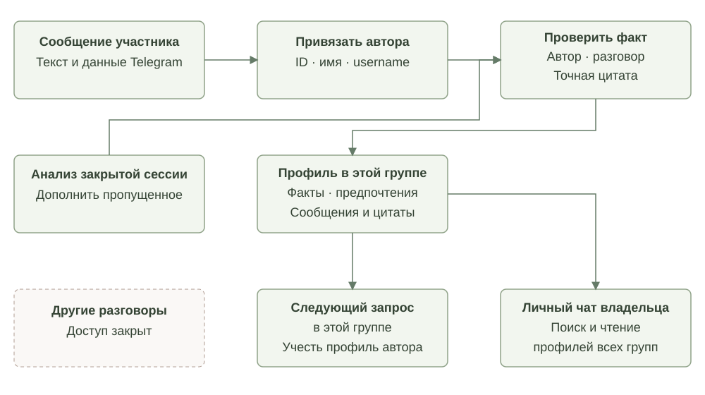

# Память

[К содержанию](README.md)

Память помогает OpenAlbert учитывать значимые обстоятельства пользователя в новых сессиях. Запоминание происходит автоматически; команда «запомни» может дополнить этот процесс, но не является обязательным условием.

Согласованы автоматическое обновление, несколько видов памяти и обязательный анализ закрытой сессии. Конкретная классификация, структура файлов и критерии отбора ниже — рабочее предложение.

## Предлагаемые виды памяти

- **Профиль** — устойчивые сведения и предпочтения. Компактная часть доступна как `USER.md`.
- **Текущий контекст** — проекты, планы и обстоятельства, полезные в ограниченный период времени.
- **Эпизоды и решения** — содержательные резюме разговоров и событий со ссылками на источники.
- **Опыт работы** — наблюдения о выполненных действиях и результатах, которые могут помочь в дальнейшем.

Актуальное состояние поручений находится в системе задач. Память может ссылаться на задачу, но ответ о её статусе проверяется через инструменты задач. Характер хранится отдельно в `SOUL.md`; опыт работы не изменяет skills без согласования.

## Что стоит запоминать

Рабочий критерий: может ли сведение изменить будущий полезный ответ, действие или инициативу?

«Не люблю ранние вылеты» может стать предпочтением. «В следующем месяце переезжаю» — временным обстоятельством. «Для проекта выбрали Temporal» — решением в контексте проекта. Разовое настроение обычно остаётся в истории сессии, пока нет оснований считать его устойчивым обстоятельством.

У воспоминания должны быть понятны происхождение, время и область применения. Прямое высказывание пользователя отличается от гипотезы агента. Новые сведения могут уточнять или заменять прежние; повторное упоминание не должно создавать отдельную копию того же воспоминания.

Для личного и группового общения используются отдельные области памяти. Личный чат владельца имеет доступ на чтение к сохранённой истории и памяти всех групп. Каждая группа видит только собственный разговор; личная переписка и другие группы ей недоступны.

## Личный чат как общий контекст владельца

| Откуда обращается пользователь | Что агент может читать |
| --- | --- |
| Личный чат владельца | Своя история и память, история и память всех известных боту групп и топиков |
| Группа или топик | Только история и память этого разговора |
| Личный чат другого разрешённого пользователя | Только его собственная история и память |

Владелец задаётся настройкой запуска `TELEGRAM_OWNER_USER_ID`; по умолчанию это первый ID в `TELEGRAM_ALLOWED_USER_IDS`. Доступ проверяется кодом по ID владельца и адресату личного чата. `SOUL.md` не выдаёт прав. Поле `owner_id` у группового разговора обозначает последнего отправителя и не определяет владельца установки.

В личном чате агент использует `conversation_list` для списка групп и `conversation_history` для чтения и поиска по сообщениям разных сессий, включая активные. `memory_search` по умолчанию ищет в личной и групповой памяти. В результатах остаются исходная область, сессия и источник: сообщение участника группы не становится фактом о владельце. Для `memory_read` найденной групповой записи передаётся её `conversation_id`.

История и память групп подгружаются по необходимости, целиком в системный prompt они не попадают. Изменения памяти продолжают относиться к текущему разговору. Чтение группы в личном чате само по себе ничего в неё не отправляет и не меняет её память. По прямому поручению владельца инструмент `send_group_message` может отправить отдельный публичный текст в выбранную разрешённую группу или топик. Обычный ответ владельцу остаётся в личном чате. Уже сохранённые обсуждения тоже доступны.

Доступна только переписка, которую Telegram доставил и приложение приняло с учётом списков разрешённых групп и отправителей. Название группы и ID автора сохраняются для новых сообщений; для старых записей эти сведения могут отсутствовать. `session_started_at` — время начала сессии, а не точное время каждой реплики. Ответы через `send_message` показаны с признаком `reply_requested`: это запись запроса отправки, а не подтверждение доставки Telegram. История выдаётся страницами, большие фрагменты отмечаются как усечённые.

## Профили участников групп

[Исходник схемы](diagrams/participant-profiles.mmd)

В каждой группе или топике у участника есть отдельный профиль по стабильному Telegram ID. Имя и username берутся из метаданных Telegram, а не из догадок модели. Одинаковые имена не объединяют людей; смена имени не создаёт нового человека. Один участник в разных группах имеет отдельные записи, которые автоматически не смешиваются.

Если участник пишет «Я люблю пончики», агент может автоматически сохранить это как его предпочтение через `participant_update`. Для записи нужны `user_id`, `source_message_id` и точная цитата. Код проверяет, что исходное сообщение действительно принадлежит этому участнику в этой группе и содержит цитату. Слова другого человека и ответы самого бота не служат источником личного предпочтения. Семантический отбор полезных фактов делает модель; точная цитата подтверждает происхождение, но сама по себе не гарантирует безошибочное понимание смысла.

Метаданные участника сохраняются при обработке сообщения. Полезные сведения извлекаются во время общения, а анализ закрытой сессии дополняет пропущенное с теми же проверками автора и источника. Для старых сообщений без надёжной привязки к автору и исходному событию профиль не угадывается. Сведения извлекаются из текста или подписи принятого сообщения; фотографии, документы и пересказы других участников не заменяют собственное высказывание человека.

При следующем обращении профиль автора подгружается в контекст. `participant_search` ищет по имени, username, ID и сохранённым фактам; `participant_read` показывает профиль с источниками. В личном чате владельца доступны профили известных групп. Другие группы и личные чаты доступа не получают. Запись профиля разрешена только в исходной группе; она не изменяет личный `USER.md` владельца и не записывает предпочтение одного участника как предпочтение всей группы.

На хосте файлы находятся в `container_data/knowledge/scopes/<хеш разговора>/participants/<Telegram ID>/`: `IDENTITY.md` содержит метаданные, `PROFILE.md` — читаемую сводку фактов с источниками и цитатами. Исходные факты остаются отдельными записями памяти с `subject_user_id`. Принятые исправления и удаление факта пересобирают сводку. Для удаления через инструмент нужна просьба самого участника, а не соседа по чату; анализ сессии с удалением не восстанавливает забытый факт.

Бот не выгружает список всех участников. Профили появляются у авторов сообщений, доставленных Telegram и принятых приложением. В разрешённых группах принимаются все обычные участники; для личных чатов остаётся список `TELEGRAM_ALLOWED_USER_IDS`. Настройки Telegram могут ограничивать сообщения, которые бот получает.

## Профиль в MVP

`USER.md` автоматически собирается из записей памяти двух типов:

- `profile` — основные сведения о пользователе: имя, место жительства, часовой пояс;
- `preference` — явно выраженные устойчивые предпочтения, например «предпочитаю короткие ответы».

Агент обновляет профиль через `memory_update`; отдельного инструмента редактирования `USER.md` нет. Исправление или удаление исходной записи сразу пересобирает профиль. Личный `USER.md` попадает в контекст новых сессий своего разговора. В группах личные сведения участников направляются в отдельные профили.

Контекстные факты (`fact`), эпизоды (`episode`) и предположения (`hypothesis`) доступны через поиск памяти и не добавляются в `USER.md`. Просьба «пришли завтра анекдот в 07:10» создаёт разовую задачу. Она не означает постоянного предпочтения или ежедневного расписания. Если в той же просьбе пользователь сообщает «живу в Москве», место жительства сохраняется отдельно как `profile`.

Эти правила действуют и для анализа закрытой сессии. Он может исправить неверный тип существующей записи, сохранив её идентификатор и происхождение. Семантический выбор типа делает модель, поэтому неоднозначные случаи всё ещё могут требовать исправления.

## Запись и последующий анализ

[Исходник схемы](diagrams/memory-flow.mmd)

По ходу разговора агент может сохранить значимое сведение через `memory_update`. При закрытии сессии отдельный процесс обязательно анализирует всю завершённую сессию: ищет пропущенное, проверяет прежние записи и создаёт резюме. Анализ может закончиться без изменения памяти.

Все обновления проходят через один механизм записи. Он согласует изменения разных сессий и фоновых запусков, сохраняет историю и не позволяет позднему анализу молча перезаписать более новое исправление пользователя. Точный способ согласования предстоит выбрать.

Просьба пользователя исправить или забыть сведения применяется и к текущим записям, и к их поисковым представлениям. Автоматический анализ старых источников должен учитывать такое решение, чтобы не восстановить удалённую запись. Срок хранения первичной истории и резервных копий пока не определён.

## Текстовые файлы и поиск

Для первой версии предлагается Markdown-память на постоянном томе ядра. Отдельные заметки посвящены понятным темам и содержат ссылки на исходные разговоры, задачи или документы. Служебные отметки можно хранить рядом с текстом; конкретный формат пока не фиксируется.

Инструменты `memory_search` и `memory_read` предоставляют поиск и чтение. В текущей реализации поиск лексический и не учитывает регистр: запрос разбивается по пробельным символам, каждый фрагмент должен встретиться в содержимом, источнике или типе одной записи. Пунктуация остаётся буквальной; запятая не означает «или». Нет перевода, синонимов, морфологии, регулярных выражений и wildcard-синтаксиса. `Polka` найдёт запись о проекте, а `Polka, Лейкерс` потребует оба фрагмента вместе с запятой в одной записи.

Описание инструмента рекомендует начинать с одного характерного имени или слова, разные темы искать отдельно, а при пустой выдаче сокращать запрос или пробовать другое написание. Добавление слов сужает поиск. `query: ""` возвращает до 50 последних обновлённых доступных записей; это обзор, а не полный экспорт. Пустая выдача означает отсутствие совпадений с запросом, а не отсутствие памяти или интересов пользователя.

Поисковые индексы, если появятся, восстанавливаются из основных записей. Они не становятся независимой редактируемой копией памяти.

## Использование в новой сессии

В контекст входит компактный профиль. Уже переданные факты агент использует напрямую. Остальное он запрашивает для конкретного пробела в информации: `memory_search` — сохранённые факты и предпочтения, `task_find`/`task_read` — поручения, расписания и результаты, `conversation_history` — прежние сообщения. Пустой поиск не отменяет сведения из профиля или других источников. Получив достаточный контекст, агент прекращает поиск.

Фоновое пробуждение сначала направляет агента к переданному профилю и существующим задачам. Дополнительный поиск памяти нужен при конкретном недостатке сведений; при необходимости общего обзора допускается один запрос `query: ""`. Абстрактные списки вроде «интересы, проекты, планы» и повторные поиски без причины инструкция запрещает.

Пример: при новом поиске билетов агент находит предпочтение о времени вылета и учитывает его без повторной просьбы пользователя. Воспоминание о прошлой поездке не должно автоматически превратиться в условие новой задачи.

## Как проверять полезность памяти

На следующем этапе нужны сценарии, которые проверяют полный путь: важное сведение естественно появляется в разговоре, сохраняется, находится в новой сессии и корректно влияет на действие. Отдельные случаи — изменившееся предпочтение, временный план, удалённое воспоминание и разделение личного и группового контекста.

Правила забывания, степень допустимых предположений и отбор сведений при росте компактного `USER.md` остаются открытыми решениями.
