# Логирование и диагностика

[К содержанию](README.md)

В собственном коде Jarvis используется подход **Wide Events — широкие события**. Логи всех контейнеров поступают в **VictoriaLogs через logging driver контейнерной среды**. Это общие эксплуатационные требования к компонентам системы.

## Широкие события

Референс — статья Boris Tane [Logging Sucks](https://loggingsucks.com/). Основная идея: для завершённой операции формируется одно содержательное структурированное событие, которое объединяет её контекст, результат и длительность. Контекст накапливается во время работы и выводится итоговой записью. Одного перехода на JSON для этого недостаточно: событие должно объяснять, что произошло с операцией.

Для Jarvis единицей такого события служит ограниченная операция: обработка входящего сообщения, попытка вызова LLM, выполнение инструмента, доставка ответа, анализ сессии или шаг фоновой задачи. Событие помогает понять, с какой работой была связана операция, что она использовала и чем закончилась.

## Границы событий в Jarvis

Длительная задача может существовать несколько дней. Её шаги и переходы состояний логируются по мере выполнения; ожидание следующего расписания не откладывает всю диагностику до завершения задачи.

В событии сохраняется подходящий операции контекст: связь с разговором, сессией, задачей и запуском, использованные модель или инструмент, длительность, исход и причина ошибки. Для LLM также полезны сведения о расходе токенов, когда они доступны. Реализованные поля и примеры поиска описаны ниже.

Связь между операциями передаётся через границы каналов, Workflow и Activities. Поэтому по задаче можно найти связанные вызовы модели, инструменты и попытки доставки сообщения. После добавления Computer box тот же контекст передаётся для удалённых действий.

## Temporal и повторные попытки

Каждая фактическая попытка Activity имеет собственный итог и связь с исходной операцией. Если инструмент выполнился со второй попытки, в логах должны быть видны и первая ошибка, и последующий успех.

Повторное воспроизведение Workflow не должно выглядеть как новое внешнее действие. Итоговые события вызовов LLM и инструментов формируются при реальном исполнении Activities. Прерванная аварией процесса попытка может остаться без итоговой записи; её состояние восстанавливается по данным Temporal и последующим событиям.

VictoriaLogs используется для диагностики. Актуальное состояние задач, очередь доставки и история исполнения продолжают храниться в предназначенных для них хранилищах приложения и Temporal.

## Путь логов контейнеров



[Исходник схемы](diagrams/logging-pipeline.mmd)

Go-компоненты выводят широкие события в stdout/stderr как отдельные JSON-записи. Logging driver на Docker-хосте забирает потоки, добавляет сведения об источнике и отправляет их в VictoriaLogs. Приложению не требуется самостоятельно подключаться к хранилищу логов.

Общий путь доставки применяется ко всем контейнерам развёртывания Jarvis: ядру, workers, Temporal, PostgreSQL и вспомогательным службам. Для сторонних компонентов сохраняется их собственный формат логирования; Wide Events вводятся в коде, который разрабатывается для Jarvis. После MVP удалённая машина, доступная только по SSH, будет передавать результаты команд через адаптер ядра; включение её собственных контейнеров в общую доставку потребует настройки на её Docker-хосте.

В Compose используется встроенный Docker-драйвер `splunk`. Он отправляет события в `log-gateway` на порту 9429. Этот небольшой Go-сервис принимает HEC-пакеты, снимает обёртку Docker и записывает нормализованный JSON Lines в VictoriaLogs. Отдельный Splunk или агент на хосте не нужен. Приложение продолжает писать в stdout/stderr, а все контейнеры используют один logging driver.

Нормализованные поля имеют короткие имена: `service`, `container`, `project`, `level`, `operation`, `turn_id` и остальные метаданные wide event. Сервис и проект берутся из Docker labels, имя контейнера — из tag; эти значения имеют приоритет над полями, напечатанными приложением. Они образуют отдельные потоки VictoriaLogs. `_msg` начинается с имени сервиса: `[jarvis]`, `[temporal]`, `[postgres]` и т. д. Уровень расположен в стандартном поле `level`, поэтому VMUI распознаёт INFO/WARN/ERROR без ручных настроек.

Для обычного режима Temporal запускается с `LOG_LEVEL=warn`: его многочисленные сообщения об обслуживании очередей не заполняют список. `TEMPORAL_LOG_LEVEL=info` в настройках запуска возвращает подробную диагностику. Штатные предупреждения и ошибки сохраняются.

Шлюз возвращает успешное подтверждение драйверу только после ответа 2xx от VictoriaLogs. Невалидный пакет не пересылается частично. Ошибка backend возвращает 503 для штатных повторов драйвера; URL, заголовки и тело ошибки в ответ не копируются. Шлюз не пишет каждую ошибку доставки в собственный вход, чтобы не образовать бесконечный цикл логирования. `/healthz` на порту 9429 показывает состояние процесса и счётчики принятых и неуспешных пакетов. Оба внешних порта, 9428 и 9429, опубликованы только на loopback.

Источники: [Docker Splunk logging driver](https://docs.docker.com/engine/logging/drivers/splunk/), [JSON Lines в VictoriaLogs](https://docs.victoriametrics.com/victorialogs/data-ingestion/).

При настройке проверяется, что содержимое JSON-события доступно в VictoriaLogs как структурированные данные для поиска, а метаданные контейнера позволяют определить источник записи.

## Доставка и доступность

Настройка драйвера входит в общий шаблон запуска контейнеров. Отдельно выбираются буферизация, повторная отправка и поведение при недоступности VictoriaLogs. Эти настройки определяют, может ли приложение ждать записи лога и при каких условиях возможна потеря данных. Docker описывает соответствующие режимы в [документации logging drivers](https://docs.docker.com/engine/logging/configure/).

Порядок запуска не должен создавать циклическую зависимость между контейнером и приёмом его собственных логов. Если VictoriaLogs также развёрнут контейнером, для его логов применяется то же требование доставки; механизм первоначального запуска и буферизации нужно проверить отдельно.

В широкие события включаются диагностические метаданные. Секреты и полное содержимое переписки, prompt или памяти по умолчанию в логи не выводятся; для материалов используются ссылки на сохранённые артефакты.

## Читаемые сообщения и контекст

События версии `log_schema_version=3` содержат описания действий на русском языке; gateway добавляет источник, сохраняя отдельные поля для машинного поиска. Например:

```text
[jarvis] Открыта страница в Chromium · example.com · 1.7 с · обращение 4e119a30
[jarvis] Получен ответ модели · deepseek-v4.1-flash · 17.4 с · токены: 14811 вход / 2591 выход · обращение 4e119a30
[jarvis] Ответ отправлен в Telegram · 142 мс · обращение 4e119a30
```

Это примеры формы сообщения, а не конкретный запуск. Для фильтрации используются отдельные поля `operation`, `tool`, `result`, `duration_ms`, `model` и остальные метаданные.

`turn_id` совпадает с устойчивым ключом одного запуска обработки: он связывает подготовку контекста, вызовы модели и инструментов, итог и доставку ответа. `session_id` объединяет несколько таких обращений в одной сессии. `trigger` различает `message`, `task` и `initiative`; `task_id` связывает фоновые запуски одной задачи. Несколько входящих сообщений могут быть объединены в один запуск; поэтому `telegram.receive` содержит `incoming_id`, а `turn.prepare` — соответствующий список `incoming_ids` и `turn_id`. Назначить один turn заранее в момент получения сообщения невозможно.

Activities дополнительно содержат `workflow_id`, `workflow_run_id`, `activity_id`, `attempt`. Повторное чтение готового результата отмечается `cached=true`; такой лог не означает повторного обращения к провайдеру или выполнения действия. Вызовы инструментов содержат `step`, `tool_call_id`, имя инструмента, а при наличии — домен назначения, размер результата, число записей или ID артефакта. URL пути, параметры запросов, аргументы заполнения и тексты результатов не выводятся.

## Итог обращения и доставка

`turn.finish` измеряет сохранение состояния. Отдельное широкое событие `turn.complete` содержит:

- `processing_ms`: время от начала запуска в Workflow до завершения обработки, включая ожидания и повторы;
- `since_received_ms`: время от самого раннего принятого сообщения, когда известна его дата;
- `model_calls`, `tool_calls`, `tool_errors`: число логических вызовов и ошибок инструментов;
- `input_tokens`, `output_tokens`: сумма токенов возвращённых результатов модели; не оценка расхода неуспешных запросов без usage;
- `tools`, `incoming_count`, `finish_reason` и `delivery_state`.

Счётчики отражают логические шаги, а отдельные попытки видны по `attempt` в событиях Activities. При добавлении нового сообщения в текущую обработку накопленные счётчики сохраняются. У исторических запусков, начавшихся до обновления, время начала может отсутствовать; переход совместим с историями Temporal.

`delivery_state=queued` в итоге обработки означает постановку ответа в outbox. Фактическую отправку подтверждает `telegram.deliver` с `delivery_state=sent`. Сохранённая запись outbox переносит тот же `turn_id` через перезапуск. Событие доставки содержит `queue_wait_ms`, `since_turn_started_ms`, `since_received_ms`, номер попытки и сведения о части ответа. `first_part=true` отмечает успешно отправленную первую часть; текст и вложение имеют отдельные подтверждения. При ошибке сохранения подтверждения ставится `state_persist_failed`, а не ложное `sent`.

## Ошибки действий

`result` описывает исход операции. Если инструмент не выполнил действие, но Activity успешно вернула описание ошибки модели, событие имеет `result=error`, `tool_outcome=error`, `activity_result=success`. Ошибка инструмента при этом не превращается в техническую ошибку Activity и не меняет политику повторов.

Ожидание свободного Chromium отмечается `result=waiting`, отмена — `result=cancelled`; оба состояния имеют уровень WARN. Ошибки содержат безопасные `error_code`, `error_reason`, `retryable`, а HTTP-ошибки — также `http_status`. Например: `timeout`, `http_403`, `http_429`, `browser_capacity`, `stale_element`. `retryable` означает диагностическую возможность повторения, а не разрешение вслепую повторить действие с неизвестным исходом. Неизвестная причина остаётся `operation_failed`; произвольный текст исключения в логи не копируется.

## Поиск по контейнерам и обращениям

Ниже готовые LogsQL-запросы для VMUI или `/select/logsql/query`. Конфигурация хранится в `compose.yaml`; настроек в браузере или ручного создания фильтров после установки не требуется.

```text
# Только Jarvis
service:jarvis

# Только Temporal
service:temporal

# PostgreSQL
service:postgres

# Все ошибки Jarvis
service:jarvis result:error

# Итоги обращений
service:jarvis operation:turn.complete

# Конкретное обращение: замените значение
 turn_id:"TURN_ID"

# Компактная таблица с уже нормализованными полями
 service:jarvis | fields _time, service, level, _msg, turn_id
```

Старые записи не переписываются: у них остаются прежние `event.line.*`, `event.attrs.compose_service` и `event.tag`. Новые поля и сообщения появляются после пересоздания контейнеров; в широком временном диапазоне могут одновременно присутствовать обе схемы. Для применения изменения общей конфигурации драйвера нужен `docker compose up -d --build`, обычного `restart` недостаточно. Существующие volumes и история сохраняются.

## Открытые решения

- Требуемая надёжность доставки и размер буфера под реальную нагрузку. В MVP выбран неблокирующий буфер `4m`; при его переполнении логи могут теряться.
- Срок хранения под реальное использование. В Compose начальное значение — 30 дней.

Для Go используется `slog` с накоплением полей и одной итоговой JSON-записью на операцию. Сквозная проверка Compose подтверждает появление широких событий приложения и логов инфраструктурных служб в VictoriaLogs, включая сам сборщик. Команды воспроизведения и ограничения доставки — в [руководстве запуска](development.md).

## Подробная инспекция сессий

Тексты сообщений, снимки контекста модели, аргументы и результаты инструментов доступны в [инспекторе сессий](inspector.md) на `http://localhost:8080/inspect/`. Они хранятся в PostgreSQL отдельно от Wide Events: VictoriaLogs остаётся журналом операционных событий без тел переписки.
