# Логирование и диагностика

[К содержанию](README.md)

В собственном коде OpenAlbert используется подход **Wide Events — широкие события**.
Операционные события сохраняются во **встроенную таблицу SQLite `openalbert_logs`**
(с автоматической очисткой записей старше 30 дней) и одновременно выводятся в
stdout/stderr в формате JSON. Внешний сервер сбора логов не требуется: самодиагностика
через `logs_search` работает из коробки.

## Широкие события

Референс — статья Boris Tane [Logging Sucks](https://loggingsucks.com/). Основная идея: для завершённой операции формируется одно содержательное структурированное событие, которое объединяет её контекст, результат и длительность. Контекст накапливается во время работы и выводится итоговой записью. Одного перехода на JSON для этого недостаточно: событие должно объяснять, что произошло с операцией.

Для OpenAlbert единицей такого события служит ограниченная операция: обработка входящего сообщения, попытка вызова LLM, выполнение инструмента, доставка ответа, анализ сессии или шаг фоновой задачи. Событие помогает понять, с какой работой была связана операция, что она использовала и чем закончилась.

## Границы событий в OpenAlbert

Длительная задача может существовать несколько дней. Её шаги и переходы состояний логируются по мере выполнения; ожидание следующего расписания не откладывает всю диагностику до завершения задачи.

В событии сохраняется подходящий операции контекст: связь с разговором, сессией, задачей и запуском, использованные модель или инструмент, длительность, исход и причина ошибки. Для LLM также полезны сведения о расходе токенов, когда они доступны.

Связь между операциями передаётся через границы каналов, встроенного оркестратора и шагов исполнения. Поэтому по задаче можно найти связанные вызовы модели, инструменты и попытки доставки сообщения. Вызовы Computer box записываются как операции tools; команды и их вывод не включаются в операционные логи.

## Повторные попытки и восстановление

Каждая фактическая попытка шага имеет собственный итог и связь с исходной операцией. Если инструмент выполнился со второй попытки, в журнале видны и первая ошибка, и последующий успех.

Чтение сохранённой контрольной точки (checkpoint) после перезапуска отмечается `cached=true` и не выглядит как новое внешнее действие. Прерванная аварией процесса попытка может остаться без итоговой записи; её состояние восстанавливается по записям состояния и контрольных точек в SQLite.

Таблица `openalbert_logs` используется для диагностики. Актуальное состояние задач, очередь доставки и история исполнения хранятся в своих таблицах операционного состояния SQLite.

## Путь и хранение логов



[Исходник схемы](diagrams/logging-pipeline.mmd)

Go-приложение `openalbert` использует `slog` с накоплением полей и одной итоговой JSON-записью на операцию:

1. **Встроенное хранилище `openalbert_logs` (`DATA_DIR/openalbert.db`)** — сохраняет структурированные широкие события OpenAlbert в ту же SQLite-базу в режиме WAL с индексацией по времени, разговору, сессии, обращению и операции. Фоновая очистка автоматически удаляет записи старше **30 дней**.
2. **Потоки stdout/stderr** — дублируют JSON-события в стандартный вывод процесса. В Docker Compose все контейнеры (`openalbert`, `stt`, `tts`, `backup`) используют встроенный драйвер Docker `local` с ротацией (`max-size: 10m`, `max-file: 3`). При запуске голого бинарника `./openalbert` вывод можно направить в systemd/journald или файл.

Просмотр контейнерных логов вспомогательных сервисов и приложения:

```sh
docker compose logs --tail=100 openalbert
docker compose logs --tail=100 stt
docker compose logs --tail=100 backup
```

Агент получает сведения о резервировании через отдельные status/events из `./backup-state`, а не через логи контейнера `backup`. [Настройка контейнера резервирования](deployment.md#настройка-контейнера-резервирования).

В широкие события включаются диагностические метаданные. Секреты и полное содержимое переписки, prompt или памяти по умолчанию в логи не выводятся; для материалов используются ссылки на сохранённые артефакты и трассы инспектора.

## Читаемые сообщения и контекст

События содержат описания действий на русском языке и отдельные поля для точной фильтрации: `operation`, `tool`, `result`, `duration_ms`, `model`, `conversation_id`, `session_id`, `turn_id` и остальные метаданные. Например:

```text
Открыта страница в Chromium · example.com · 1.7 с · обращение 4e119a30
Получен ответ модели · deepseek-v4.1-flash · 17.4 с · токены: 14811 вход / 2591 выход · обращение 4e119a30
Ответ отправлен в Telegram · 142 мс · обращение 4e119a30
```

Это примеры формы сообщения, а не конкретный запуск.

`turn_id` совпадает с устойчивым ключом одного запуска обработки: он связывает подготовку контекста, вызовы модели и инструментов, итог и доставку ответа. `session_id` объединяет несколько таких обращений в одной сессии. `trigger` различает `message`, `task`, `initiative` и `coding`; `task_id` связывает фоновые запуски одной задачи. Несколько входящих сообщений могут быть объединены в один запуск; поэтому `telegram.receive` содержит `incoming_id`, а `turn.prepare` — соответствующий список `incoming_ids` и `turn_id`.

Повторное чтение готового результата из контрольной точки отмечается `cached=true`; такой лог не означает повторного обращения к провайдеру или выполнения действия. Вызовы инструментов содержат `step`, `tool_call_id`, имя инструмента, номер попытки `attempt`, а при наличии — домен назначения, размер результата, число записей или ID артефакта. URL пути, параметры запросов, аргументы заполнения и тексты результатов не выводятся.

## SQL в широких событиях

Запросы к встроенной SQLite накапливаются в событии текущей операции:
подготовке контекста, вызове модели или инструмента, сохранении состояния,
анализе сессии, приёме и доставке сообщения. Отдельная запись на каждый запрос
не создаётся. Инициализация базы имеет событие `database.initialize`.

HTTP API приложения, включая инспектор и клиентский HTTP API, формирует одно событие
`http.request` с `request_id`, `http_method`, `http_route`, `http_status` и SQL-метриками.
`http_route` — зарегистрированный шаблон маршрута, например
`GET /api/inspect/sessions/{id}`. Реальный URL, query-параметры, заголовки и тела
не копируются. Статика и `/healthz` не создают событий запросов API.

Если операция выполнила SQL, её событие содержит:

- `db_query_count`, `db_duration_ms`: число завершённых вызовов и сумма их длительностей;
- `db_rows`, `db_error_count`: число затронутых/прочитанных строк и число ошибок запросов;
- `db_slow_query_count`: число вызовов длительностью не менее 100 мс;
- `db_max_duration_ms`, `db_slowest_query`: длительность и шаблон самого медленного вызова;
- `db_queries`: до 16 различных SQL-шаблонов, с `query_id`, `sql`, `count`,
  `duration_ms`, `max_duration_ms`, `rows`, `error_count`, в порядке убывания суммарного времени;
- `db_queries_omitted`: число вызовов, которые не попали в список после достижения
  лимита различных шаблонов. Общие счётчики и самый медленный вызов учитывают их.

Повторяющиеся шаблоны объединяются, поэтому видны и многочисленные быстрые
запросы. Пробельные символы в шаблоне сворачиваются; `query_id` — SHA-256 полного
нормализованного шаблона. Поле `sql` ограничено 2048 байтами; обрезка отмечается
`sql_truncated=true`, идентификатор при этом рассчитывается до обрезки.
SQL остаётся параметризованным: логируется шаблон из кода, а не значения аргументов.
Результаты запросов, пути и тексты пользовательских данных в SQL-метаданные не включаются.

У фонового SQL без открытого события сохраняются только медленные вызовы
(от 100 мс) и ошибки как `operation=db.query`. Быстрое успешное фоновое
опрашивание не создаёт отдельного лога.

## Итог обращения и доставка

`turn.finish` измеряет сохранение состояния. Отдельное широкое событие `turn.complete` содержит:

- `processing_ms` и `duration_ms`: время от начала обработки до её завершения, включая ожидания и повторы;
- `since_received_ms`: время от самого раннего принятого сообщения, когда известна его дата;
- `model_calls`, `tool_calls`, `tool_errors`: число логических вызовов и ошибок инструментов;
- `input_tokens`, `output_tokens`: сумма токенов возвращённых результатов модели; не оценка расхода неуспешных запросов без usage;
- `tools`, `incoming_count`, `finish_reason` и `delivery_state`.

Счётчики отражают логические шаги, а отдельные попытки видны по `attempt` в событиях шагов. При добавлении нового сообщения в текущую обработку накопленные счётчики сохраняются.

`delivery_state=queued` в итоге обработки означает постановку ответа в outbox. Фактическую отправку подтверждает `telegram.deliver` с `delivery_state=sent`. Сохранённая запись outbox переносит тот же `turn_id` через перезапуск. Событие доставки содержит `queue_wait_ms`, `since_turn_started_ms`, `since_received_ms`, номер попытки и сведения о части ответа. `first_part=true` отмечает успешно отправленную первую часть; текст и вложение имеют отдельные подтверждения. При ошибке сохранения подтверждения ставится `state_persist_failed`, а не ложное `sent`.

## Ошибки действий

`result` описывает исход операции. Если инструмент не выполнил действие, но обработчик успешно вернул описание ошибки модели, событие имеет `result=error`, `tool_outcome=error`.

Ожидание свободного Chromium отмечается `result=waiting`, отмена — `result=cancelled`; оба состояния имеют уровень WARN. Ошибки содержат безопасные `error_code`, `error_reason`, `retryable`, `error_source` (например, `model`, `browser`, `web`, `telegram`), `error_stage`, а HTTP-ошибки — также `http_status`. Например: `timeout`, `http_403`, `http_429`, `browser_capacity`, `stale_element`. `retryable` означает диагностическую возможность повторения, а не разрешение вслепую повторить действие с неизвестным исходом. Неизвестная причина остаётся `operation_failed`; произвольный текст исключения или ответа внешнего провайдера в логи не копируется.

Реальные вызовы модели и инструментов содержат `trace_id` и `inspector_url`: ссылка открывает конкретный вызов в панели инспектора, включая неудачные попытки. Базовый адрес задаётся `INSPECTOR_PUBLIC_URL` (по умолчанию `http://localhost:8080/inspect/`). Он должен быть доступен из браузера пользователя. Чтение контрольной точки не создаёт новый вызов и не получает вымышленную трассу.

## Самодиагностика и инспектор

Сам OpenAlbert читает встроенный журнал `openalbert_logs` через инструмент `logs_search` **из коробки**, без дополнительной настройки. Инструмент разрешён в личном чате владельца и его запланированных задачах, включая ночную диагностику; группы, другие личные чаты и инициативные проверки не имеют к нему доступа. Он возвращает ограниченную сводку и выборку событий OpenAlbert по разрешённому разговору. Полные тексты запросов модели и результатов действий в ответ не попадают. Правила и примеры вопросов — в [диагностике собственных действий](tools.md#диагностика-собственных-действий).

При необходимости таблицу `openalbert_logs` в `DATA_DIR/openalbert.db` можно также опрашивать напрямую через `sqlite3` в режиме только для чтения (например, для анализа медленных запросов, ошибок или расхода поиска).

Тексты сообщений, снимки контекста модели, аргументы и результаты инструментов доступны в [инспекторе сессий](inspector.md) на `http://localhost:8080/inspect/`. Они хранятся в таблицах `openalbert_messages` и `openalbert_traces` отдельно от `openalbert_logs`: журнал событий остаётся компактным и не содержит тел переписки.
