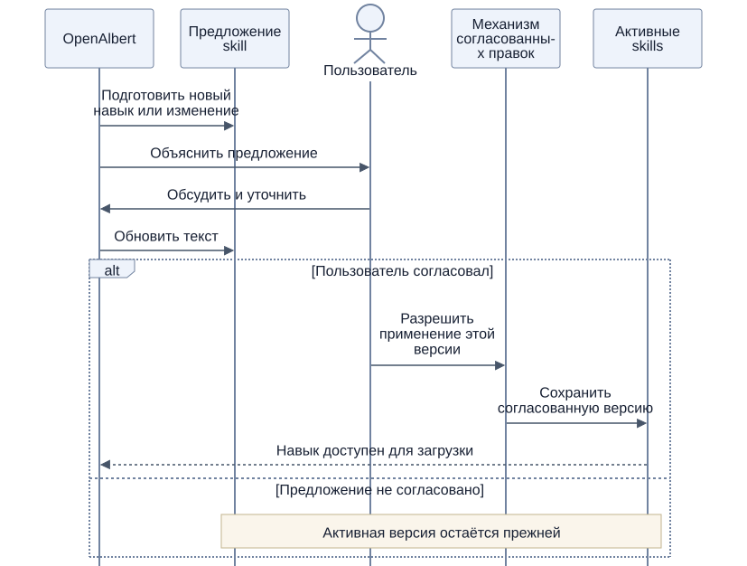

# Личность, skills и контекст

[К содержанию](README.md)

## Кто что изменяет

Имя и характер хранятся в `container_data/knowledge/SOUL.md`. Пользователь может редактировать файл или попросить агента изменить его в личном диалоге, например: «Теперь тебя зовут Атлас, обнови своё имя». Агент читает актуальный текст через `soul_read` и применяет точечную правку через `soul_update`, сохраняя остальную инструкцию. Изменения действуют при подготовке следующего запроса. SOUL общий для всех разговоров. Из групп, фоновых задач и проверок инициативы запись запрещена кодом. Автоматическая запись памяти и анализ сессий не редактируют этот документ. Подробности — в [руководстве запуска](development.md#как-задать-характер).

Имя, личность и роль помощника задаются в SOUL, например «Ты — OpenAlbert…». Базовая инструкция ядра не закрепляет конкретное имя. Шаблон для нового хранилища находится в `internal/knowledge/templates/SOUL.md` и встраивается в приложение при сборке; он используется только при создании отсутствующего SOUL внутри `KNOWLEDGE_DIR`. Существующий файл пользователя не заменяется шаблоном.

Skills формируются совместно. OpenAlbert может предложить новый навык или изменение существующего, подготовить текст и объяснить пользу. Активная версия меняется после согласования с пользователем. Полностью самостоятельное изменение навыков не предполагается.

Профиль и память автоматически пополняются в рамках [процесса работы с памятью](memory.md). Учитывая предпочтения пользователя, агент действует в пределах заданного характера.

## Сборка контекста

[Исходник схемы](diagrams/prompt-context.mmd)

В базовую часть входят правила работы OpenAlbert, `SOUL.md`, компактный `USER.md`, названия и описания доступных skills, а также определения начальных tools. Правила объясняют, когда следует читать память, проверять статус задач и загружать навык.

Контекст конкретной сессии содержит её сообщения и результаты предыдущих шагов. Полный текст skill, найденные воспоминания, подробности задач и документы появляются после вызова соответствующего инструмента. При фоновом запуске начальное событие сообщает, какое поручение или проверку нужно продолжить; само состояние задачи читается через tool.

Все задачи, вся память и все тексты skills в системную часть не загружаются. Версии базовых инструкций и навыков, использованных при запуске, стоит сохранять для объяснения поведения агента.

## Навык как способ выполнения работы

Skill описывает, когда он полезен, как выполнить работу доступными средствами и как проверить результат. В MVP это может быть порядок исследования темы или подготовки регулярной сводки с помощью поиска, памяти и задач. После добавления Computer box навык сможет объяснять управление браузером на удалённой машине или отправку письма через установленную там программу.

Базовому ядру не нужен отдельный встроенный инструмент для каждого такого приложения. Агент читает подходящий skill и использует доступные инструменты текущей версии. Навык не добавляет отсутствующие возможности удалённого исполнения. Если для навыка нужен новый доступ или программа, их настройка обсуждается отдельно.

## Совместное развитие навыков

[Исходник схемы](diagrams/skill-change.mmd)

Предложение хранится отдельно от действующего skill. До согласования новая инструкция не включается в каталог активных навыков. После согласования приложение применяет новую версию и сохраняет историю изменения. Обновлённый навык доступен при следующей загрузке; уже выполняемая операция сохраняет сведения о использованной версии.

Обнаруженный опыт можно записать в память и предложить превратить в skill. Такая запись сама по себе не меняет действующую процедуру выполнения работы.

## Граница изменений

Tools записи доступны для памяти, предложений навыков и согласованных в личном диалоге правок `SOUL.md`. Публикация активной версии skill по-прежнему требует совместного обсуждения и ручного применения. `soul_update` заменяет ровно один совпадающий фрагмент; неоднозначная или устаревшая правка отклоняется. Файл сохраняется атомарно и ограничен 12000 символами, чтобы целиком помещаться в контекст характера. Широкий shell-доступ к основному контейнеру в начальный набор tools не входит; Computer box и выполнение рабочих команд отложены до следующего этапа.

Для изменения имени или характера достаточно прямого указания в личном диалоге; отдельного ручного редактирования файла не требуется. Изменения skills предполагают совместное обсуждение.
