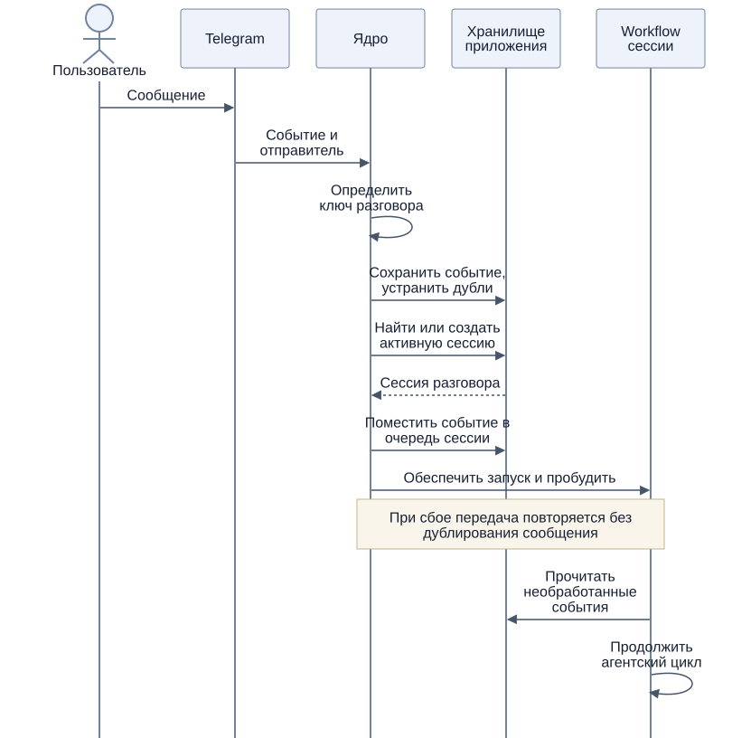

# Разговоры, сессии и агентский цикл

[К содержанию](README.md)

## Основные понятия

**Разговор** — длительная история общения в определённой области: личное общение пользователя с OpenAlbert или отдельная группа. Он переживает множество сессий. Личный чат владельца может читать историю групп через отдельные инструменты, сохраняя собственную сессию. Группы читают только свой разговор.

**Сессия** — ограниченный период обработки сообщений разговора со своим контекстом. Она создаётся при необходимости и закрывается после завершения текущей работы и периода неактивности.

**Агентский цикл** — исполнение, которое читает новые события, вызывает LLM и инструменты, сохраняет результаты и ожидает продолжения. Для разговорной сессии он обрабатывает очередь сообщений. Фоновая задача также может запускать агентский цикл без активного общения.

**Задача** — сохраняемое поручение с независимым жизненным циклом. Закрытие сессии не завершает задачу.

Пока принятое сообщение пользователя остаётся в обработке, Telegram показывает «печатает». Приложение проверяет очередь раз в секунду и обновляет индикатор раз в четыре секунды для каждого активного разговора. После завершения обработки обновление прекращается; Telegram снимает индикатор при получении ответа либо по истечении его короткого срока. Ошибка индикатора не останавливает подготовку и доставку ответа. Фоновые задачи и инициатива сами по себе индикатор не включают. См. [sendChatAction](https://core.telegram.org/bots/api#sendchataction).

Если обработка интерактивного запроса длится больше 30 секунд, приложение создаёт одно тихое сообщение статуса в исходном чате или топике. Весь текст статуса, включая итог ошибки или остановки, отображается курсивом. Агент может обновлять его содержимое через `report_progress`: коротко описывать выполненную работу, следующий шаг или конкретную помеху. Инструмент сохраняет последнее состояние и не завершает цикл. Приложение объединяет частые обновления, редактирует сообщение не чаще раза в минуту и не повторяет неизменившийся текст. Пока агент не сообщил этап, используется нейтральное «Работаю над запросом…». Фоновые задачи и инициатива таких сообщений не создают.

После завершения работы статус ждёт подтверждения доставки всех частей ответа и вложений, затем удаляется. Постановка ответа в очередь ещё не означает доставку. При ошибке запроса или остановке уже созданный статус редактируется на «Не удалось завершить запрос» или «Остановлено» и остаётся в переписке. При неизвестном или неуспешном исходе отправки результата сохраняется пояснение о доставке. Быстрый запрос не получает запоздалого сообщения статуса.

Состояние и Telegram message ID хранятся в PostgreSQL. После перезапуска редактирование и удаление продолжают использовать тот же ID. Если подтверждение самого первого сообщения потеряно, второе сообщение статуса не создаётся. Удалённый пользователем статус также не восстанавливается. Повтор редактирования неизменённого текста и повтор удаления уже удалённого сообщения считаются успешными операциями. См. [editMessageText](https://core.telegram.org/bots/api#editmessagetext) и [deleteMessage](https://core.telegram.org/bots/api#deletemessage).

## Как сообщение попадает в сессию

[Исходник схемы](diagrams/message-routing.mmd)

1. Адаптер устанавливает отправителя и канал. Ядро определяет ключ разговора по привязке личного аккаунта либо по группе и, при необходимости, топику.
2. Входящее событие сохраняется с защитой от дублей.
3. По ключу разговора находится активная сессия. Если её нет, создаётся новая. Параллельные входящие сообщения не должны создать две активные сессии одного разговора.
4. Сообщение попадает в очередь сессии, а её Workflow получает сигнал о работе. Повторная доставка сигнала допустима при устранении дублей событий.

Соотнесение текста с задачей происходит внутри агента через tools. Для выбора сессии анализ смысла сообщения не нужен.

## Начать новый диалог

Отправь `/new`, чтобы явно начать новую сессию в текущем чате или топике. Команда также доступна в меню команд Telegram: с клавиатуры набери `/new` и отправь сообщение. В группе можно использовать `/new@имя_бота`.

Команда обрабатывается приложением без вызова модели. Она останавливает текущий запрос и сообщения перед командой, ещё ожидающие обработки, закрывает прежнюю сессию и подтверждает начало новой. Следующие сообщения получают чистый контекст; они не теряются, даже если пришли во время переключения. Повторная доставка одной команды не создаёт дополнительную сессию или подтверждение.

История разговора и долговременная память сохраняются, независимые задачи продолжают работать. Для прежней сессии запускается обычный последующий анализ. `/stop` останавливает текущую работу без смены сессии. Обе команды регистрируются в меню Telegram при запуске приложения.

## Агентский цикл

[Исходник схемы](diagrams/agent-loop.mmd)

Модель получает сообщения текущей сессии, базовые инструкции и результаты уже вызванных tools. Задачи, воспоминания и полные тексты skills подгружаются по необходимости. Модель может выполнить несколько шагов инструментами до подготовки ответа.

При ответе на конкретное сообщение Telegram в контекст и историю добавляется снимок исходного сообщения: его ID в текущем чате, автор, текст или подпись к вложению и типы медиа. Выбранная цитата передаётся отдельно, с её текстом и позицией в UTF-16; она обозначает конкретный фрагмент, на который отвечает пользователь. Форматированные сообщения бота без обычного текста передаются как блоки rich message. Цитируемый текст отделён от нового сообщения и не считается словами текущего отправителя. Вложения исходного сообщения автоматически не скачиваются, цепочка ответов не разворачивается. Контекст сохраняется вместе с входящим сообщением, поэтому доступен и при ответе на сообщение из предыдущей сессии.

Ответ пользователю отправляется через инструмент доставки. Успешный `send_message` завершает обработку текущего запроса после выполнения текущей группы инструментов. Цикл не вызывает модель снова только ради подтверждения отправки или ожидания пользователя. Обычный финальный ответ модели без вызовов инструментов завершает запуск, сохраняется только в его истории и не отправляется пользователю; пустой текст или специальный маркер не требуются. Для ответа, уточнения или уведомления модель явно вызывает `send_message`; фоновая проверка может завершиться без сообщения. Прогресс и расписание задачи перед завершением сохраняются через `task_update`. В журнале запуск без сообщения имеет `finish_reason=no_reply` и `delivery_state=not_requested` — это диагностические поля, а не отдельный инструмент.

После завершения ответа сессия ожидает следующее сообщение до таймаута неактивности. Расписания и ожидания фоновых задач управляются их отдельными Workflow, как описано в [исполнении задач](tasks.md#исполнение-через-temporal).

Новые сообщения во время Activity сохраняются в очереди. Перед следующим содержательным действием агент учитывает накопившиеся сообщения. Внутри сессии предлагается последовательно принимать решения, чтобы два шага не меняли её контекст одновременно.

Команда «стоп» должна иметь отдельную обработку: она останавливает дальнейшие шаги и запрашивает отмену текущей операции, если та поддерживается. Уже выполненное внешнее действие автоматически не отменяется. Остановка текущего цикла и отмена длительной задачи различаются; при неясной формулировке агент уточняет намерение.

## Закрытие сессии

[Исходник схемы](diagrams/session-closing.mmd)

Таймер неактивности закрывает сессию, когда нет необработанных сообщений и текущих шагов. Для события на границе закрытия ядро либо оставляет его в ещё активной сессии, либо создаёт новую. Событие должно оказаться ровно в одной из них.

По умолчанию таймаут составляет 30 минут (`SESSION_IDLE_TIMEOUT=30m`) и отсчитывается после завершения обработки последнего запроса. Технический перезапуск `SessionWorkflow` через Temporal Continue-As-New не закрывает разговорную сессию: сохраняются её ID, контекст, браузер, очередь сообщений и защита от повторной обработки. Перезапуск ограничивает служебную историю исполнения и не запускает анализ сессии. Его задержка входит в уже начавшийся таймаут неактивности.

Для каждой закрытой сессии надёжно запускается анализ: проверка сохранённой памяти, извлечение пропущенного, исправление противоречий, резюме и проверка зафиксированных поручений. Повтор анализа после сбоя не должен создавать дубли воспоминаний или задач.

Если обнаружено потерянное поручение, анализ сохраняет его либо помечает необходимость уточнения. Он не должен незаметно повторять уже выполненную работу.

Новая сессия может начаться до завершения анализа предыдущей. Актуальные задачи доступны через инструменты независимо от анализа; оригинальная история разговора также сохраняется. Долговременная память дополняется по мере завершения анализа.

## Переход между каналами — после MVP

В MVP единственный интерфейс — Telegram. Следующие правила описывают расширение после добавления desktop app.

Предлагаемое правило доставки: прямой ответ идёт в канал сообщения, которое его вызвало. Личная история доступна в обоих привязанных каналах. Фоновые уведомления используют настроенный личный канал; результаты групповой работы остаются в соответствующей группе.

Если пользователь пишет одновременно в Telegram и desktop app, события входят в общую очередь личного разговора. Правило выбора адресата для объединённого ответа требует отдельного решения; автоматическую отправку во все каналы не предполагаем.
