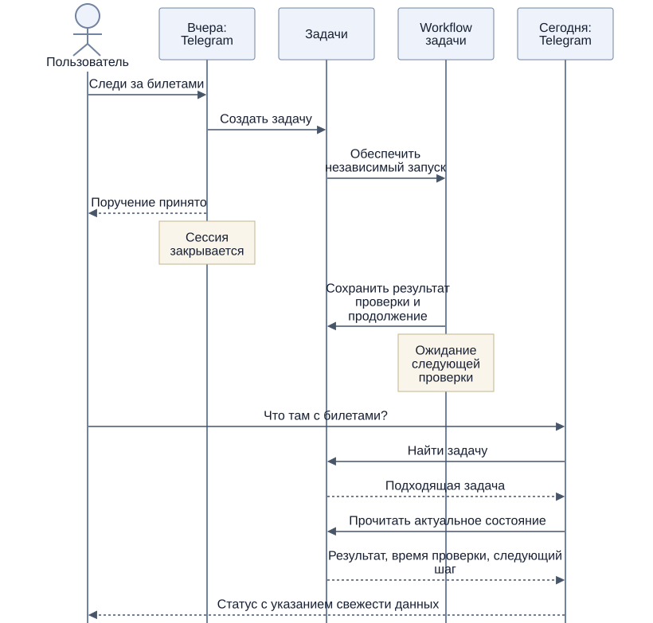

# Задачи

[К содержанию](README.md)

Задача — постоянное поручение Jarvis. Она может появиться по просьбе пользователя или по инициативе агента. Несколько сессий и фоновых запусков могут обращаться к одной задаче; исходный разговор остаётся её источником, но не определяет срок её жизни.

## Что сохраняется между запусками

Агенту нужны цель и ограничения поручения, актуальное состояние, уже полученные результаты и понятное продолжение работы. Для самостоятельной задачи также сохраняется причина: какой интерес или обстоятельство пользователя побудили Jarvis ею заняться.

Операционный статус предлагается хранить в PostgreSQL. Развёрнутый план, заметки и материалы могут быть текстовыми документами, связанными с задачей. Результат выполненного шага сохраняется сразу, чтобы новый запуск продолжал работу с последнего известного состояния.

Все задачи в system prompt не включаются. Через инструменты агент ищет нужные задачи и получает их подробности. Фоновый запуск знает, какую задачу он продолжает, и читает её актуальное состояние перед работой.

## Жизненный цикл

[Исходник схемы](diagrams/task-lifecycle.mmd)

Ожидание — нормальное состояние длительной задачи. Агент может ждать расписания, внешнего события или ответа пользователя. После добавления Computer box возможна также пауза до доступности нужной машины. Для продолжения сохраняется причина ожидания и соответствующий способ пробуждения.

Разовый поиск завершается с результатом. Мониторинг остаётся активным и чередует выполнение и ожидание до условия остановки или отмены. Завершённые проверки сохраняются в истории такой задачи.

Приостановка сохраняет возможность продолжения. Отмена прекращает будущую работу; уже выполненные внешние действия учитываются отдельно. Неисправимая ошибка фиксируется вместе с последним известным результатом.

## Исполнение через Temporal

Предлагается отдельный Workflow длительной задачи, который управляет её шагами и ожиданиями. Он не зависит от Workflow разговорной сессии. Задача как сущность приложения также не привязывается навсегда к одному техническому запуску Workflow.

Сессия создаёт поручение и обеспечивает его запуск. Workflow задачи выполняет шаги через Activities, сохраняет результат и назначает следующее продолжение. Завершение сессии не должно автоматически отменять этот Workflow.

Изменение задачи во время исполнения доставляется её Workflow. Например, новый предел цены должен учитываться перед следующим действием, а отмена — предотвращать новые шаги. Обновления одного поручения согласуются через единый механизм управления задачами.

## Статус в новой сессии

[Исходник схемы](diagrams/task-status.mmd)

Пример: вчера пользователь поручил отслеживать билеты в Telegram, сессия завершилась, а сегодня он пишет снова: «Есть что-нибудь по билетам?» Новая сессия находит задачу через `task_find`, читает её через `task_read` и отвечает по последнему сохранённому результату.

Статус должен отражать и свежесть данных: «Последняя проверка была час назад; подходящих вариантов не было; следующая проверка вечером». Если требуется новый поиск, агент запускает проверку через управление задачей. Чтение статуса само по себе не означает повторного выполнения работы.

Если найдено несколько подходящих задач, агент задаёт уточнение. Поиск ограничивается областью разговора и доступами пользователя.

## Инициативные задачи

Jarvis может сам заводить длительные задачи, когда видит связь с интересами пользователя. Для каждой формулирует ожидаемую пользу и условие завершения либо пересмотра. Доступные действия определяются существующими tools, skills и выданными доступами.

Вопрос «чем ты сейчас занимаешься?» должен позволять получить и поручения пользователя, и самостоятельные задачи с объяснением их происхождения. Правила уведомлений описаны в [фоновой работе](background.md).
