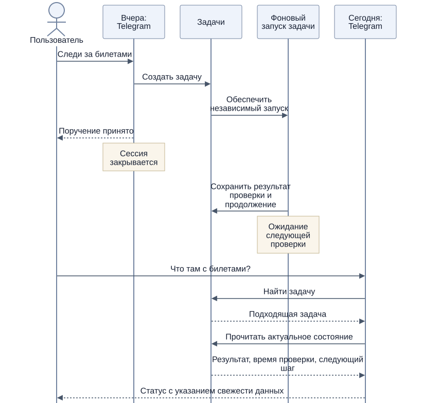

# Задачи

[К содержанию](README.md)

Задача — постоянное поручение OpenAlbert. Она может появиться по просьбе пользователя или по инициативе агента. Несколько сессий и фоновых запусков могут обращаться к одной задаче; исходный разговор остаётся её источником, но не определяет срок её жизни.

## Что сохраняется между запусками

Агенту нужны цель и ограничения поручения, актуальное состояние, уже полученные результаты и понятное продолжение работы. Для самостоятельной задачи также сохраняется причина: какой интерес или обстоятельство пользователя побудили OpenAlbert ею заняться.

Операционный статус и расписание хранятся в SQLite (`DATA_DIR/openalbert.db`). Развёрнутый план, заметки и материалы могут быть текстовыми документами или артефактами, связанными с задачей. Результат выполненного шага сохраняется сразу, чтобы новый запуск продолжал работу с последнего известного состояния.

Все задачи в system prompt не включаются. Через инструменты агент ищет нужные задачи и получает их подробности. Фоновый запуск знает, какую задачу он продолжает, и читает её актуальное состояние перед работой.

## Жизненный цикл

[Исходник схемы](diagrams/task-lifecycle.mmd)

Ожидание — нормальное состояние длительной задачи. Агент может ждать расписания, внешнего события или ответа пользователя. При недоступности Computer box задача может сохранить ID операции и назначить следующую проверку. Для продолжения сохраняется причина ожидания и соответствующий способ пробуждения.

Разовый поиск завершается с результатом. Мониторинг остаётся активным и чередует выполнение и ожидание до условия остановки или отмены. Завершённые проверки сохраняются в истории такой задачи.

Приостановка сохраняет возможность продолжения. Отмена прекращает будущую работу; уже выполненные внешние действия учитываются отдельно. Неисправимая ошибка фиксируется вместе с последним известным результатом.

## Исполнение во встроенном оркестраторе

Длительные задачи исполняются встроенным Go-оркестратором и планировщиком поверх SQLite независимо от разговорных сессий. Задача как сущность приложения не привязана к одному запуску процесса и переживает перезапуски.

Сессия создаёт поручение в SQLite и ставит его на исполнение. Оркестратор выполняет шаги задачи с сохранением контрольных точек, записывает результат и назначает следующее время запуска. Завершение разговорной сессии не отменяет задачу.

Изменение задачи во время исполнения сразу фиксируется в базе и учитывается исполнителем: новый предел цены влияет на следующий шаг, а отмена или пауза предотвращают новые шаги. Обновления одного поручения согласуются с проверкой версии через единый механизм управления задачами.

## Статус в новой сессии

[Исходник схемы](diagrams/task-status.mmd)

Пример: вчера пользователь поручил отслеживать билеты в Telegram, сессия завершилась, а сегодня он пишет снова: «Есть что-нибудь по билетам?» Новая сессия находит задачу через `task_find`, читает её через `task_read` и отвечает по последнему сохранённому результату.

Статус должен отражать и свежесть данных: «Последняя проверка была час назад; подходящих вариантов не было; следующая проверка вечером». Если требуется новый поиск, агент запускает проверку через управление задачей. Чтение статуса само по себе не означает повторного выполнения работы.

Если найдено несколько подходящих задач, агент задаёт уточнение. Поиск ограничивается областью разговора и доступами пользователя.

## Инициативные задачи

OpenAlbert может сам заводить длительные задачи, когда видит связь с интересами пользователя. Для каждой формулирует ожидаемую пользу и условие завершения либо пересмотра. Доступные действия определяются существующими tools, skills и выданными доступами.

Вопрос «чем ты сейчас занимаешься?» должен позволять получить и поручения пользователя, и самостоятельные задачи с объяснением их происхождения. Правила уведомлений описаны в [фоновой работе](background.md).
