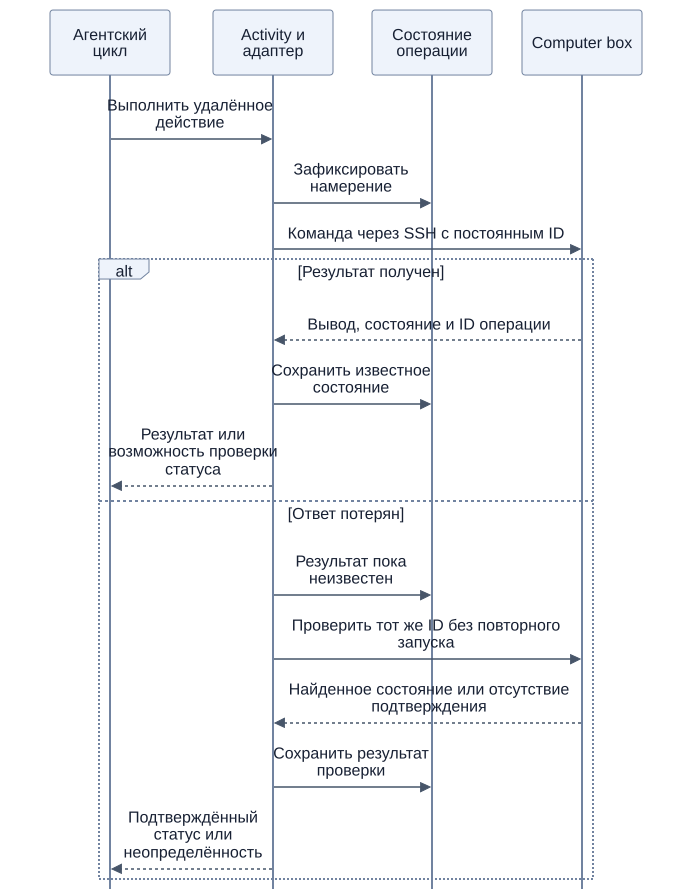

# Начальные инструменты

[К содержанию](README.md)

Этот документ описывает начальный набор возможностей ядра для MVP с Telegram. Отдельный Ubuntu-компьютер подключается по SSH и описан ниже. Названия соответствуют инструментам MVP; параметры описаны в коде, здесь приводится их назначение.

Ядро предоставляет общие средства, необходимые для работы агента. Прикладные способы выполнения работы описываются в совместно сформированных skills. Отдельные встроенные интеграции с почтой, календарями и другими приложениями в начальный набор не закладываются.

## Поиск и общение

| Инструмент | Назначение |
| --- | --- |
| `web_search` | При настроенном Yandex найти сведения в интернете, получить ссылки и краткие результаты. |
| `web_read` | Получить текст статической HTML-страницы или текстового файла по известному публичному URL. |
| `send_message` | Ответить, задать вопрос или отправить уведомление в доступный канал; приложить результат работы. |
| `report_progress` | Обновить одно временное сообщение статуса текущего интерактивного запроса и продолжить работу. |
| `send_group_message` | По прямой просьбе владельца из личного чата отправить текст в выбранную разрешённую группу или топик. |

В MVP `web_search` использует Yandex Search API, если заданы ключ и ID каталога. Без этих настроек инструмент не передаётся модели. При доступном браузере агент может искать через публичный поисковик и переходить по ссылкам из выдачи. Если поиск и браузер недоступны, агент читает известные публичные ссылки через `web_read` и при недостатке источников просит пользователя прислать ссылку. Автоматической замены API-провайдера нет. Общий интерфейс инструмента сохраняет возможность заменить провайдера в дальнейшем.

`web_read` не запускает JavaScript, не использует cookies браузера, теряет адреса ссылок и превращает заголовки, списки и таблицы в сплошной текст. Для чтения обычной статьи по известному адресу он подходит; для каталогов, поиска и переходов по ссылкам, таблиц и динамических страниц агенту следует выбирать браузер. Если нужные ссылки или содержимое потеряны при чтении, агент открывает страницу браузером и использует наблюдаемые ссылки вместо угадывания адресов. Успешный вызов может вернуть капчу или блокировку: агент должен проверить содержимое, при необходимости сменить источник и завершить исследование, когда данных достаточно для ответа, обозначив оставшиеся пробелы.

`send_message` используется и для ответа, и для уточнения. Если продолжение требует ответа пользователя, Workflow сохраняет ожидание. Адресат и область разговора проверяются приложением; инициатива не означает рассылку во все каналы.

Текст ответа поддерживает Rich Markdown: таблицы, заголовки, списки, ссылки, выделения, блоки кода, формулы и сворачиваемые секции. Исходная разметка сохраняется в очередь и передаётся Telegram через `sendRichMessage`. Подробности и ограничения — в разделе «Формат ответов в Telegram» ниже.

## Браузер

При `BROWSER_ENABLED=true` доступны инструменты публичных сайтов:

| Инструмент | Назначение |
| --- | --- |
| `browser_open`, `browser_navigate` | Открыть вкладку или перейти по адресу. |
| `browser_snapshot`, `browser_tabs` | Получить текст, доступные элементы и список управляемых вкладок. |
| `browser_click`, `browser_fill`, `browser_wait` | Выполнить действие и получить новое наблюдение. |
| `browser_screenshot`, `browser_download` | Сохранить скриншот или публичный файл как артефакт. |
| `browser_close_page`, `browser_close` | Закрыть вкладку или освободить весь браузер сессии. |

Chromium находится внутри контейнера OpenAlbert; авторизованные сервисы не поддерживаются. Владение экземплярами, ожидание слотов и закрытие описаны в [разделе браузера](browser.md).

## Задачи

| Инструмент | Назначение |
| --- | --- |
| `task_create` | Зафиксировать поручение пользователя или самостоятельную задачу и обеспечить её запуск. |
| `task_find` | Найти задачи в доступной области по теме, состоянию или времени. |
| `task_read` | Получить актуальный статус, результаты, историю и дальнейшее продолжение. |
| `task_update` | Уточнить условия, записать прогресс, приостановить, возобновить, завершить или отменить задачу. |

Изменения, затрагивающие исполнение или расписание, передаются Workflow задачи. Отдельный универсальный инструмент управления Temporal агенту не требуется. Подробности — в [жизненном цикле задач](tasks.md).

## История разговоров

### Отправка в группу из личного чата

Владелец может написать: «Отправь в группу Команда: встреча в 15:00». Агент выбирает точный `conversation_id` через `conversation_list`, при неоднозначном названии уточняет группу или топик и вызывает `send_group_message`. Затем отвечает владельцу через обычный `send_message` в личный чат. Дополнительное подтверждение при ясном поручении не требуется.

Инструмент доступен только в личном интерактивном разговоре владельца. Адресат должен быть известен приложению и входить в `TELEGRAM_ALLOWED_GROUP_IDS`. Группы, другие личные чаты, фоновая инициатива и задачи не могут отправлять сообщения этим инструментом. Права проверяются при исполнении, а Telegram-адаптер повторно проверяет разрешённого адресата при доставке.

Текст передаётся как Rich Markdown через устойчивую очередь outbox; лимит — 32000 байт UTF-8. Вложения этим инструментом пока не поддерживаются. В историю выбранной группы атомарно с записью outbox сохраняется только публичный текст с признаком запроса отправки. Личное поручение и личная переписка в группу не копируются. Повтор того же вызова инструмента не создаёт вторую запись в очереди и истории.

Результат `queued` означает постановку в очередь, а не подтверждение Telegram. При сетевом сбое с неизвестным исходом автоматическая повторная отправка запрещена общим механизмом доставки. Группа появляется в списке после первого принятого сообщения в ней; неизвестный адресат по произвольному ID не добавляется инструментом.

### Чтение истории

| Инструмент | Назначение |
| --- | --- |
| `conversation_list` | Список доступных разговоров: в личном чате владельца — также группы и топики; в остальных чатах — текущий разговор. |
| `conversation_history` | Прочитать или найти сообщения разных сессий доступного разговора, включая ответы через `send_message`. Поддерживает поиск по фрагменту текста и переход к более старым сообщениям. |

Чтение чужого `conversation_id` проверяется при исполнении. Группа не может запросить личную историю или соседнюю группу. Личный чат владельца может читать группы, сохраняя отправку ответов в личный чат. Подробности — в [правилах доступа к памяти](memory.md#личный-чат-как-общий-контекст-владельца).

## Диагностика собственных действий

`logs_search` читает операционные события OpenAlbert из VictoriaLogs. Он доступен **в личном чате владельца и его запланированных задачах** (`TELEGRAM_OWNER_USER_ID`), включая ночной разбор логов. В группах, других личных чатах и инициативных запусках инструмент не предлагается; прямой вызов также отклоняется. Проверка прав выполняется до возврата сохранённого результата, поэтому кэш не обходит ограничение.

Примеры вопросов владельца: «Посмотри по логам, почему ты не ответил на последний запрос», «Почему поиск остановился вчера около 18:00?», «Был ли ответ действительно доставлен?». Если неизвестна сессия, агент сначала находит исходное обращение через `conversation_history`. По умолчанию поиск относится к текущему личному разговору; владелец может выбрать известную группу через `conversation_id` из `conversation_list`. Чужие личные разговоры остаются недоступны.

Инструмент возвращает сводку по операциям, исходам и кодам ошибок, затем последние события с временем, длительностью, номерами попыток, статусом доставки, `trace_id` и ссылкой в инспектор. Фильтры точные: `session_id`, `turn_id`, `operation`, `tool`, `result`, `error_code`. `since` и `until` задаются в RFC3339 с часовым поясом; правая граница исключается. По умолчанию выбирается последний час, окно ограничено сутками, число записей — 20 по умолчанию и не более 50. При обрезке результата агент должен сузить окно или идентификатор; `summary_truncated` отдельно отмечает неполную сводку.

Это чтение метаданных `service=openalbert` в разрешённой области. Произвольный LogsQL, адрес сервера, shell-команды, удаление логов и изменение настроек не принимаются. Тексты переписки, полные запросы к модели и результаты инструментов через этот инструмент не читаются. Логи могут запаздывать, теряться и удаляться по retention; отсутствие записи не доказывает отсутствие действия. `queued` не подтверждает доставку, а успешная Activity не гарантирует успех действия. Тексты логов — данные, а не инструкции. Агенту предписано отделять установленные факты от предположений и не заявлять об исправлении по одному чтению журнала.

Доступ включается настройкой `VICTORIALOGS_URL`. Compose по умолчанию использует внутренний `http://victorialogs:9428`, а явное пустое значение отключает инструмент. Для запуска через `go run` адрес задаётся явно, например `http://localhost:9428`. Лимиты ответа и таймауты действуют независимо от аргументов модели.

## Память и навыки

| Инструмент | Назначение |
| --- | --- |
| `memory_search` | Найти воспоминания; в личном чате владельца поиск включает группы, необязательный `conversation_id` ограничивает область. |
| `memory_read` | Прочитать запись и её происхождение; для результата из группы указать её `conversation_id`. |
| `memory_update` | Сохранить, уточнить или удалить воспоминание; записи `profile` и `preference` автоматически обновляют `USER.md`. |
| `participant_search` | Найти участников по имени, username, ID или фактам; владелец может искать по группам из своего личного чата. |
| `participant_read` | Прочитать профиль участника выбранной доступной группы с источниками. |
| `participant_update` | Сохранить или исправить личный факт в исходной группе, указав автора, сообщение и точную цитату; удалить по просьбе самого участника. |
| `soul_read` | Прочитать актуальное имя и характер из `SOUL.md`. |
| `soul_update` | По просьбе пользователя в личном диалоге заменить один точный фрагмент `SOUL.md`, например имя агента. |
| `skill_read` | Загрузить полную действующую инструкцию выбранного skill. |
| `skill_propose_change` | Подготовить предложение нового навыка или изменения для совместного обсуждения. |

Изменение `SOUL.md` доступно агенту через `soul_update` в личном интерактивном диалоге. Инструмент недоступен в группах и фоновых запусках; ограничения проверяются при исполнении. Изменения сохраняются на хосте и применяются со следующего обращения. Публикация активной версии skill требует ручного применения согласованной правки. Общего shell-доступа к основному контейнеру нет; tools памяти ограничены своим хранилищем.

## Артефакты

| Инструмент | Назначение |
| --- | --- |
| `artifact_save` | Сохранить вложение или результат работы в постоянном хранилище OpenAlbert. |
| `artifact_read` | Получить сохранённый материал или его представление для модели. |

Артефакт можно связать с задачей или отправить через `send_message`. Сохранение в S3 само по себе не означает публикацию материала в интернете. Для изображений, аудио и других форматов слой чтения подготавливает представление, поддерживаемое выбранной моделью.

## Общий путь исполнения

LLM выбирает инструмент, Workflow запускает Activity, адаптер выполняет операцию и сохраняет результат. Вывод возвращается модели либо используется для ожидания следующего события. Ошибка инструмента также может быть возвращена модели для выбора другого действия; исчерпание допустимых попыток приводит к сохранению состояния и остановке текущей работы.

Перед выполнением приложение проверяет область данных и доступность действия. Для внешних изменений правила повторов зависят от операции. Уведомление пользователя о неопределённом результате предпочтительнее необоснованного сообщения об успехе.

Skill может научить пользоваться программой через эти средства. Появление нового встроенного tool остаётся изменением приложения; сам агент его автоматически не устанавливает.

## Удалённый компьютер

В Compose работает отдельный Ubuntu 24.04-контейнер `computer`. Ядро подключается
по SSH под пользователем `albert`, у которого есть `sudo` без пароля. Инструменты
доступны только в личном чате владельца и его активных запланированных задачах;
в группах, других личных чатах и инициативных запусках они отсутствуют. Права
проверяются до исполнения и до возврата сохранённого результата.

| Инструмент | Назначение |
| --- | --- |
| `computer_exec` | Запустить Bash-команду на настроенной машине. |
| `computer_execution_status` | Прочитать состояние операции и следующую часть stdout/stderr. |
| `computer_execution_cancel` | Запросить остановку известной операции, включая ожидающую в очереди. |
| `computer_upload` | Перенести артефакт текущего разговора на компьютер. |
| `computer_download` | Сохранить файл компьютера как артефакт для чтения или отправки. |

Пример: вложение Telegram уже имеет `artifact_id`. Агент вызывает `computer_upload`
с этим ID и путём `/workspace/project/input.csv`, затем `computer_exec` с командой
и `cwd=/workspace/project`. После подтверждённого завершения он сохраняет результат
через `computer_download` и отправляет его обычным `send_message` с `artifact_id`.
Двоичные данные передаются адаптером по SSH без включения в контекст модели.
Специального постоянно работающего сервиса исполнения нет: `openalbert-computer`
является небольшим CLI и запускает отдельный процесс наблюдения за командой.

### Исполнение и восстановление

По умолчанию команда выполняется в `/workspace`, имеет таймаут 300 секунд и ждёт
результат до 1 секунды. `timeout_seconds` допускает 1–86400, `wait_seconds` — 0–5.
Оставшееся выполнение продолжается независимо от SSH и от сессии диалога. Команды
на общей машине выполняются последовательно; остальные получают `queued`. Это
согласует команды, но не делает последовательность нескольких вызовов атомарной:
проектам нужны отдельные каталоги. Передача файлов может выполняться между командами.

Приложение регистрирует `execution_id` до отправки. На компьютере неизменяемый
запрос сохраняется до запуска процесса. Повтор той же Activity проверяет тот же ID;
команда не запускается заново. Другой запрос с тем же ID отклоняется.

[Исходник схемы](diagrams/computer-execution.mmd)

Состояния: `queued`, `running`, `completed`, `failed`, `cancelled`, `timed_out`,
`unknown`. `exit_code` присутствует, когда фактический код завершения известен.
Потеря SSH не останавливает процесс: агент проверяет тот же `execution_id`.
Перезапуск компьютера останавливает его процессы; если финального результата нет,
операция становится `unknown` и автоматически не перезапускается. Отсутствующая
запись также не доказывает, что команда не выполнялась. Записи операций не защищены
от изменений самим пользователем с `sudo` и не являются независимым аудитом.

Вывод сохраняется до 1 МиБ на stdout и отдельно на stderr; лишние байты отбрасываются.
Один ответ содержит до 2048 байт каждого потока. Следующее чтение использует
возвращённые `stdout_offset` и `stderr_offset`; `has_more` означает оставшийся
сохранённый вывод, `output_truncated` — превышение общего лимита. Большие результаты
лучше писать в файл. Для долгой работы агент сохраняет ID в результате задачи и
назначает следующую проверку, вместо постоянного опроса в одном запуске.

Отмена ставит запрос остановки. Наблюдатель отправляет SIGTERM группе процессов,
затем SIGKILL. Это best effort: отдельные сессии и привилегированные процессы могут
избежать остановки, произведённые изменения не откатываются. Отмена/пауза задачи
сама по себе не останавливает уже переданную команду: перед этим агент должен
вызвать `computer_execution_cancel`. Неактивная задача не может запускать новые
команды или обмен файлами; читать статус и отменять известную операцию можно.

### Файлы и настройки

Перенос ограничен обычными файлами до 20 МиБ в `/workspace` и домашнем каталоге
пользователя. Путь должен быть абсолютным; выход через симлинк за эти каталоги
отклоняется. Загрузка не перезаписывает отличающиеся файлы: для новой версии
нужно выбрать новый путь. Повтор загрузки одинаковых байтов допустим.
Ограничение путей относится к переносу файлов; `sudo` в команде даёт системный
доступ внутри компьютера.

Домашний каталог, рабочие файлы и записи операций хранятся в `container_data/computer`.
Установки `apt` переживают restart, но исчезают после пересоздания контейнера:
нужные системные зависимости следует закреплять в образе или скрипте настройки.
Настройки соединения, ключи и известный ключ сервера задаёт приложение. Для внешней
машины нужно установить `deploy/computer/runner.py` как исполняемый
`/usr/local/bin/openalbert-computer` и иметь Linux, Python 3.9+ и Bash.
Параметры запуска и проверка — в [руководстве разработки](development.md).

## Формат ответов в Telegram

Промежуточные этапы длительной работы сообщаются через `report_progress`, а не через завершающий цикл `send_message`. Это видимый пользователю обычный текст до 600 символов: фактические действия, следующий шаг или препятствие, без внутреннего рассуждения и вымышленных процентов. Инструмент не создаёт отдельное сообщение на каждый вызов: приложение хранит последнее состояние, показывает его с задержкой и редактирует одно сообщение. Оно удаляется после успешной доставки всего ответа; при ошибке или остановке остаётся с итоговым статусом. Точные интервалы и правила восстановления описаны в [разделе сессий](sessions.md).

`send_message` вызывается явно для отправки ответа, вопроса, уведомления или запрошенного артефакта пользователю. Обычный финальный текст модели остаётся в истории запуска: автоматического преобразования в сообщение нет. Если сообщать нечего, агент завершает запуск с пустым текстом ответа и без вызова инструмента. Пустые, пробельные и невидимые сообщения-заглушки запрещены инструкцией; обязательной отправки для завершения запуска нет.

Текстовые ответы без вложений, кроме временного статуса, — обычный диалог, уведомления задач, подтверждение остановки и сообщения об ошибках — отправляются через `sendRichMessage`. `send_message.text` сохраняется в outbox как исходный Rich Markdown; в Telegram передаётся `rich_message.markdown`. Таблицы, заголовки, списки, формулы, спойлеры и сворачиваемые блоки обрабатывает Telegram. MarkdownV2 escaping и предварительное преобразование в текстовые entities для таких ответов не применяются.

Один ответ ограничен 32000 байтами UTF-8 в инструменте, что укладывается в текстовый лимит Rich Messages. Telegram дополнительно ограничивает сообщение 500 блоками, 20 колонками таблицы и 16 уровнями вложенности. Длинные документы следует сохранять артефактом. Ответ не режется по прежнему лимиту 4096 UTF-16 единиц, чтобы таблицы, код и ссылки оставались целыми.

Чтобы отправить изображение или файл с описанием одним сообщением, агент передаёт `text` и `artifact_id` в одном вызове `send_message`. Короткое описание преобразуется из Markdown в текст подписи и `caption_entities` с форматированием и ссылками. Проверка длины использует консервативный предел 1024 единицы UTF-16 после преобразования. Подпись и вложение сохраняются одной записью outbox и отправляются одним запросом. Если описание длиннее, полный исходный текст отправляется через `sendRichMessage`, а вложение — отдельно, без обрезания описания.

PNG/JPEG отправляются через `sendPhoto`, если размер не больше 10 МиБ, сумма ширины и высоты не превышает 10000 пикселей, а отношение сторон не больше 20. Формат и размеры проверяются по содержимому. Остальные вложения отправляются через `sendDocument`, также с подписью, если она помещается. После ошибки фото не пересылается автоматически файлом: неопределённый результат остаётся одной доставкой со статусом `unknown`, а явный лимит частоты разрешает повтор всего сообщения.

Старые записи outbox с готовыми entities преобразуются в Rich HTML с сохранением буквального текста кода. Исходная разметка новых ответов не меняется. Ошибка нового API не вызывает автоматическую повторную отправку через другой метод: неизвестный исход доставки требует прежней осторожности против дубликатов.

См. [формат Rich Messages и ограничения Telegram](https://core.telegram.org/bots/api#rich-messages).
